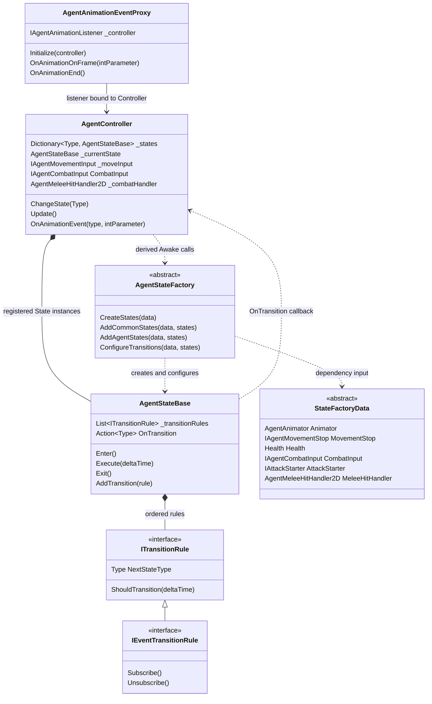
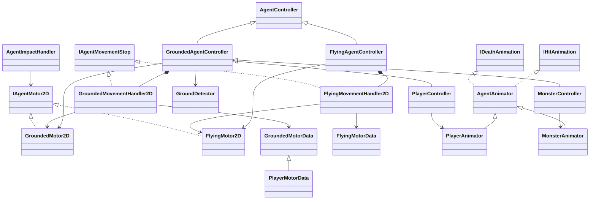
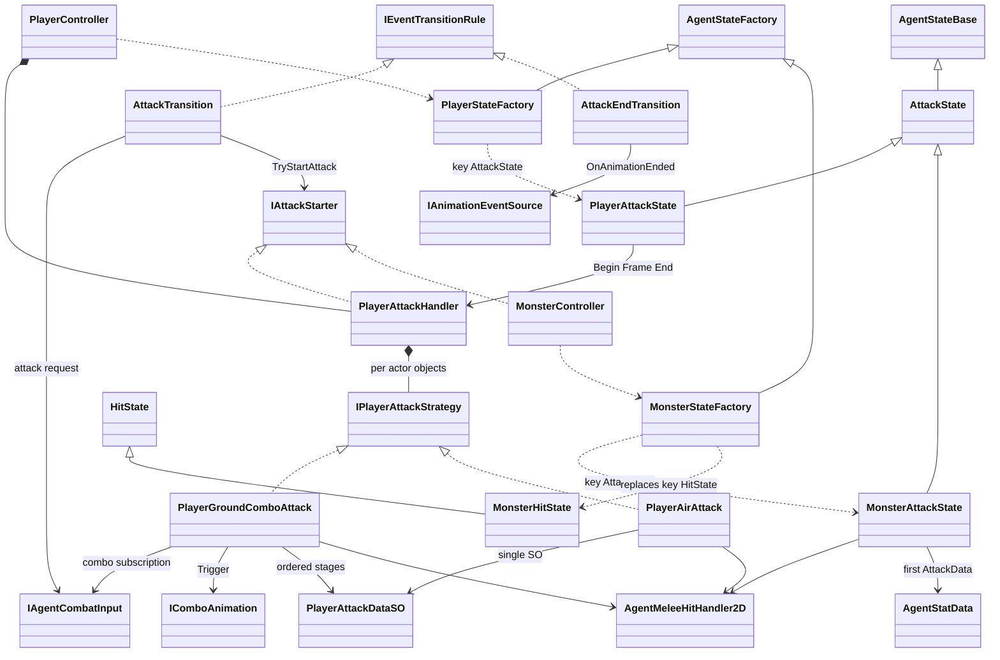
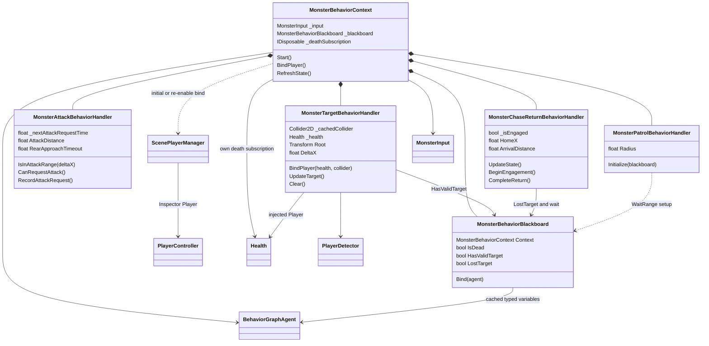
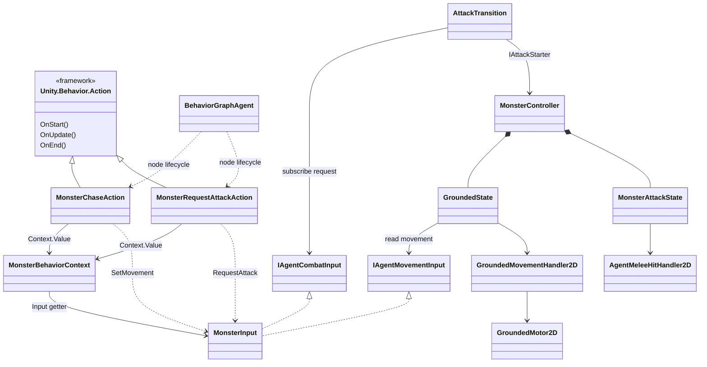

# Agent 분리 전 구조 기준선

## 1. 기록 기준

- 작성일: 2026-10-14.
- 소스 기준: `4ceef01be032a6732008bba7db951dcb5ccb7f99` (`PlayerAttack 추가 수정.`). 작업 시작 시 Git 변경사항 없음.
- 범위: 공통 FSM, 지상 Player, Grounded Monster/Goblin의 FSM·Unity Behavior, 이미 분리된 비행 이동 기반.
- 구체 Flying Monster·FlightState·Boss는 아직 구현되지 않음. 예정 구조를 현재 클래스처럼 표시하지 않음.
- 코드·Graph·Prefab 변경 없이 소스와 저장된 Graph 연결을 분석한 기록. 이번 문서 제작에서 Play 회귀·성능 측정은 수행하지 않음.

| 자료 | 구성 |
| --- | --- |
| [FSM 클래스 다이어그램](FSM_Current_Class_Diagram.pdf) | 공통 실행·Factory·Transition, Controller 프로필, Player 공격, Grounded Monster 실행 |
| [Behavior 클래스 다이어그램](Behavior_Current_Class_Diagram.pdf) | Context·Handler·Blackboard, 커스텀 Action, Input을 통한 FSM 연결 |
| 본 MD | 역할·호출 경로, 편집 가능한 Mermaid 원본, 분리 예정 지점·후속 비교 기준 |

PDF 노드는 실제 클래스의 핵심 필드·속성·메서드만 표시한다. 작은 노드의 `...`는 매개변수 생략이며 새 API를 의미하지 않는다. 전체 필드 목록은 소스가 기준이다. 묶음 관계는 같은 연결을 반복하는 클래스군을 간결히 나타낸 것이다.

## 2. 현재 역할 분담

| 구성 | 현재 책임·연결 |
| --- | --- |
| AgentController | Type Dictionary와 현재 State 보유, 실행·전환·파괴 정리. 이동/공격 Input 검색, Health·근접 타격 Component 확보, Animation Event 분배도 담당 |
| AgentStateBase | Enter에서 이벤트 규칙 구독, Execute에서 전이 순차 평가 후 행동, Exit에서 구독 해제·상태 정리 |
| ITransitionRule / IEventTransitionRule | 목적지 Type·조건 판정 / 이벤트 구독 수명. 첫 true 규칙을 선택하며 별도 숫자 Priority 없음 |
| AgentStateFactory<TData> | 공통 Hit·Death 생성 → 전용 State 추가·교체 → 최종 객체에 Transition 연결 |
| GroundedAgentController | GroundDetector·GroundedMotor·이동 Handler 초기화, FixedUpdate 접지 갱신. 점프 Input도 공통 기반에서 검색 |
| FlyingAgentController | 별도 FlyingMotor·이동 Handler 초기화. 구체 State·시작 정책은 아직 없음 |
| PlayerController | 전용 Animator·Input·Dash·Impact·공격 Handler 주입, Player Factory 구성, 초기 Grounded 진입 |
| PlayerAttackHandler | 역할/SO/모션값 보관, 개체별 전략 생성·선택, 시작 비용 판정·소비와 실행 수명 |
| MonsterController | 지상 네 State 구성, 기본 공격 가능 판정, 사망 모션 완료 후 제거. 직접 상황 판단은 하지 않음 |
| MonsterBehaviorContext | 자기 Component 캐시, ScenePlayerManager 연결, Handler·Blackboard 초기화와 갱신 순서, 자기 사망 구독 |
| Monster Behavior Handlers | 대상 판정·공격 요청 간격·교전 이력·순찰 설정. Graph나 Context를 역참조하지 않음 |
| Behavior Graph / Action | Graph는 우선순위·중단·행동 순서, Action은 Context 조회와 MonsterInput 명령 실행 |
| AgentAnimator / 전용 Animator | 공통 Hit·Death 및 파라미터 적용 유틸리티 / 개체별 표현 capability·Dictionary·SO 매핑 |

State는 Factory 생성 시 필요한 객체를 주입받는 일반 C# 객체다. AgentController 전체를 참조해 행동 함수를 호출하는 구조가 아니다. 이동 Motor·Animator·Health·Input은 Component이며, MovementHandler·공격 전략·Behavior Handler는 일반 C# 객체다.

## 3. 공통 FSM 연결



### 실행·이벤트 수명

1. 파생 Controller.Awake에서 FactoryData와 State Dictionary 구성.
2. AgentController.Start에서 각 State.OnTransition에 ChangeState 연결. 초기 상태 선택은 Player/Monster의 Start에서 수행.
3. Update → 현재 State.Execute → 등록 순서대로 ShouldTransition 평가. 첫 true에서 목적지 Type 발행 후 현재 프레임 OnExecute 생략.
4. ChangeState → 이전 State.Exit → 새 State.Enter. Exit의 이벤트 규칙 해제는 전용 OnExit보다 먼저, Enter의 구독은 OnEnter보다 먼저 수행.
5. Proxy OnFrame → Controller → 현재 AttackState.OnAttackFrame. End → Controller.OnAnimationEnded → 현재 구독 중인 종료 Transition. Death의 End만 OnDeathFinished로 전달.
6. 파괴 시 현재 State.Exit와 OnTransition 연결 해제. 비활성화/풀링의 FSM 수명은 별도 계약으로 구현되어 있지 않음.

`OnTransition`은 현재 코드에서 `event` 선언이 아닌 공개 Action 필드다. `StateMachine<T>` 파일은 남아 있지만 현재 AgentController의 실행 경로에서 사용하지 않는다.

## 4. Controller·이동·표현 프로필



- GroundedMovementHandler.Stop은 X축만 정지하여 중력을 유지. FlyingMovementHandler.Stop은 XY 전체 정지.
- Motor의 공통 IAgentMotor2D.Stop은 양쪽 모두 전체 정지. MovementStop 계약과 Motor 계약의 의미를 혼동하지 않음.
- IAgentMotor2D는 ImpactHandler에 주입되며 AgentController에 Motor 인터페이스 필드는 없음.
- GroundedMotorData·FlyingMotorData는 각각 ScriptableObject 직접 상속. AgentMotorData 공통 부모는 없음.
- AgentAnimator는 Hit·Death와 공통 setter 로직만 담당. Player는 지상·공중·공격·콤보·Dash, Monster는 지상·공격 capability를 추가.

## 5. Player와 Monster 공격·State 연결



### Player

- State 키 7개: Grounded·Jump·Fall·Dash·Attack·Hit·Death. Attack 키의 값은 PlayerAttackState.
- A 요청 → AttackTransition → PlayerAttackHandler.TryStartAttack → 전이 → PlayerAttackState.OnEnter.
- AttackDefinition은 Role·AnimatorAttackType·SO 배열을 보관. 전략·모션값은 ValueTuple로 함께 선택하고 종료까지 고정.
- 지상 GroundCombo 모션값 1·SO 3개, 공중 AirAttack 모션값 3·SO 1개. SO에는 피해·범위·비용만 보관.
- BeginAttack에서 모션값 적용·전략 시작·Stamina 한 번 소비 후 공용 Attack Bool 활성화.
- 지상은 Frame 정수 1~3으로 해당 SO 타격·입력으로 ComboTrigger 설정. 공중은 정수와 무관하게 같은 SO로 각 Event 타격.
- 콤보 순서·수락·End 분기는 Animator가 담당. 전략 End에서 구독·Trigger·Preview 정리, 공용 Exit에서 공격 Bool·모션값 초기화.
- 공격 종료는 지면이면 Grounded, 아니면 Fall. 이동/점프/Dash 정책은 이번 공격 분리와 별개로 기존 Factory에 유지.

### Grounded Monster

| 키 | 생성되는 객체 | 전이 평가 순서 |
| --- | --- | --- |
| GroundedState | GroundedState | Death → GetHit → Attack |
| AttackState | MonsterAttackState | Death → GetHit → AttackEnd(Grounded) |
| HitState | MonsterHitState | Death → GetHitEnd(Grounded) |
| DeathState | DeathState | 없음 |

MonsterController.TryStartAttack은 생존·StatData 공격 목록 존재만 확인. 공격 종류는 MonsterAttackState의 모션값 1·첫 AttackData로 고정되어 있으며 Player 전략을 사용하지 않음. 이동 입력은 GroundedState에서 소비하고, 공격·피격 진입은 수평 속도를 정지함.

## 6. Grounded Monster Behavior 연결



- Start: wrapper.Bind → Context 기록 → ChaseReturn/Patrol/Target 초기화 → 자기 사망 구독 → 씬 Player 주입·최초 판정.
- Update: 자기 사망이면 Target.Clear, 아니면 Target.UpdateTarget → ChaseReturn.UpdateState.
- Target은 주입한 단일 Player 참조를 보관. 생존·활성 → 현재 시야 중심 거리 → Linecast → 몸통 바닥 높이 차이 순서로 판정.
- Root는 거리·시야가 맞으면 유지. 높이 부적합이면 Root는 남고 HasValidTarget만 false. 대상 Root를 Blackboard에 중복 저장하지 않음.
- LostTarget은 `_isEngaged && !HasValidTarget`. HomeX는 최초 Start에만 기록하며 최대 초기 위치 거리 제한은 없음.
- Blackboard는 Context·IsDead·HasValidTarget·LostTarget·LostTargetWait·PatrolWaitMin·PatrolWaitMax와 Unity Self. 행동 설정은 Handler getter, 공통 Guard·기본 Wait는 Blackboard 사용.
- 공격 요청 간격은 Attack Handler가 개체별로 유지. Context는 Attack Handler를 소유하지만 Blackboard를 주입하거나 매 프레임 갱신하지 않음.

### Action의 실제 조회·실행 관계

모든 커스텀 Action은 `Unity.Behavior.Action`을 상속하고 `BlackboardVariable<MonsterBehaviorContext> Context` 하나를 연결한다. Action 내부는 ProjectRE namespace를 감싸지 않고 `using ProjectRE`로 참조한다.

| Action | 조회하는 Handler | 입력·종료 처리 |
| --- | --- | --- |
| MonsterPatrolAction | Patrol.Radius, ChaseReturn.HomeX/ArrivalDistance | 목적지 1회 선택·SetMovement, OnEnd 정지 |
| MonsterChaseAction | Target.DeltaX, Attack.IsInAttackRange, ChaseReturn.BeginEngagement | 공격 거리까지 이동, OnEnd 정지 |
| MonsterMoveBehindTargetAction | Target.Root/DeltaX, Attack.AttackDistance/RearApproachTimeout, ChaseReturn.ArrivalDistance | 시작 방향·종료 시각 저장, 배후 접근, OnEnd 정지 |
| MonsterRequestAttackAction | Target.DeltaX, Attack.CanRequestAttack/RecordAttackRequest | 방향 정렬·간격 대기·RequestAttack 한 번, OnEnd 정지 |
| MonsterReturnAction | ChaseReturn.HomeX/ArrivalDistance/CompleteReturn | 초기 X 이동, 정상 Success OnEnd에서만 복귀 완료 기록 |
| MonsterStopAction | 별도 Handler 없음 | OnStart에서 SetMovement(0), 즉시 Success |

RequestAttackAction은 공격 거리 재검사·추적을 하지 않는다. 거리는 Chase에서 검사. Action Success는 입력 발행 완료이며 FSM 공격 시작·Animation 종료를 의미하지 않음.

### 저장된 Graph 흐름

```text
BasicMonsterBehavior의 우선순위 선택
├─ IsDead: Stop
├─ HasValidTarget: MonsterCombatBehavior
├─ LostTarget: Stop → Wait(LostTargetWait) → Return
└─ MonsterPatrolBehavior

Combat: Chase → Random(배후 접근 / Stop) → 공통 RequestAttack
Patrol: Patrol → Stop → WaitRange(PatrolWaitMin, PatrolWaitMax)
```

기본 VariableComparisonCondition과 ConditionalGuard를 사용. 대상 재인식 시 대기·복귀·순찰에서 교전으로 복귀한다. 배후 접근 실패 후 Chase로 즉시 대체하는 Try In Order는 현재 Graph에 없음. 관련 Action의 오래된 주석을 실제 연결로 오인하지 않음. 전용 MonsterFlagCondition·MonsterWaitForTargetAction도 현재 연결/클래스에 없음.



BehaviorContext는 MonsterController를 직접 보관하지 않는다. Action은 State·Motor·Animator·피해를 직접 조작하지 않는다. Controller·현재 State·공격 시작/완료 결과를 BT에 전달하는 계약은 현재 존재하지 않는다.

## 7. 분리 예정 지점과 비교 기준

아래는 후속 리팩토링 검토 대상이며 현재 구현이 아니다.

| 주제 | 현재 기준선 | 후속 검토 방향 |
| --- | --- | --- |
| Agent 공통 경계 | Controller가 이동/공격 Input·근접 타격을 모든 Agent에 요구. OnFrame은 AttackState에 특화 | 공통 실행·수명·Health·Event 경계와 개체별 입력/공격 의존성을 분리 |
| FactoryData | 공통 Data에 Input·AttackStarter·MeleeHitHandler가 포함 | 실제 사용하는 프로필/Agent에 필요한 DI 항목 배치 |
| 지상 프로필 | GroundDetector와 Motor는 분리됐지만 기반에서 점프 Input까지 검색 | 접지·이동과 Player 점프 정책의 경계 검토. Monster 접지 기능은 보존 |
| Player 정책 | 직접 입력 → 요청 Transition → State·Player 공격 전략 | 입력 중심 정책·콤보·비용은 Player 영역 유지 |
| 단순 Monster 판단 | BT → MonsterInput → 네 State FSM, 상태 결과 회신 없음 | 상황 판단 State·Transition을 자체 Monster FSM에 배치하는 방향 검토. GroundedState에 모든 AI를 몰아넣지 않음 |
| Boss·Flying | Boss 미구현, Flying 이동 기반만 존재 | 보스 패턴 요구를 확인한 뒤 계층 FSM/패턴 조정기/BT 선택. 지상·비행 프로필과 판단 정책을 별도 축으로 설계 |

Player 공격 분리는 이미 현재 기준선에 포함되어 있다. 이전 범용 공격 Wrapper·AgentAttackAction2D·AgentCombatHandler 설계를 재도입하는 작업이 아니다.

포트폴리오에는 "기존 분리의 장점 → 새 Agent에서 공통 기반에 묶인 정책 확인 → 실행 공통화와 판단 정책 분리 → 기존 행동 보존 검증" 순서로 정리한다. 비교 항목은 기본 Controller 의존성, DI 경로, AI 명령/상태 결과 계약, 새 행동 추가 시 수정 범위, 구독 정리, 기존 Player/Goblin 회귀다. 코드량·성능 개선은 실제 변경·측정 이후에만 기록한다.

현재 수량: Player State 키 7개, Grounded Monster State 키 4개, Behavior Handler 4개, 커스텀 Monster Action 6개, 저장 Graph 3개. 클래스/상태 추가의 효과를 평가할 때 참고하되 수량 감소 자체를 개선 목표로 삼지 않음.

## 8. 주요 소스 경로

| ID | 경로 |
| --- | --- |
| S1 | `Assets/Scripts/FSM/Agent/@Hub/AgentController.cs`, `IAgentController.cs` |
| S2 | `Assets/Scripts/FSM/Agent/StateControl/AgentStateBase.cs`, `TransitionRules/ITransitionRule.cs` |
| S3 | `Assets/Scripts/FSM/Agent/StateControl/AgentStateFactory.cs` |
| S4 | `Assets/Scripts/FSM/GroundedAgent/@Hub/GroundedAgentController.cs`, `FlyingAgent/@Hub/FlyingAgentController.cs` |
| S5 | `Assets/Scripts/FSM/GroundedAgent/Handler/`, `FlyingAgent/Handler/`, 각 `SOData/`, `Agent/Move/2D/IAgentMotor2D.cs` |
| S6 | `Assets/Scripts/FSM/Agent/@Hub/AgentAnimator.cs`, `IAgentAnimator.cs`, Player/Monster의 전용 Animator |
| S7 | `Assets/Scripts/FSM/Player/@Hub/PlayerController.cs`, `Player/Input/PlayerInput.cs` |
| S8 | `Assets/Scripts/FSM/Player/Attack/`, `Player/SOData/PlayerAttackDataSO.cs` |
| S9 | `Assets/Scripts/FSM/Player/PlayerState/PlayerStateFactory.cs`, `PlayerState/States/PlayerAttackState.cs` |
| S10 | `Assets/Scripts/FSM/NPC/AIMonstor/@Hub/MonsterController.cs`, `MonsterState/`, `Input/MonsterInput.cs` |
| S11 | `Assets/Scripts/FSM/Agent/StateControl/States/`, `GroundedAgent/StateControl/States/`, `Agent/StateControl/TransitionRules/Attack/` |
| S12 | `Assets/Scripts/FSM/Agent/Handler/AgentAnimationEventProxy.cs`, `AgentMeleeHitHandler2D.cs`, `AgentImpactHandler.cs` |
| S13 | `Assets/Scripts/FSM/NPC/AIMonstor/@Behavior/MonsterBehaviorContext.cs`, `MonsterBehaviorBlackboard.cs` |
| S14 | `Assets/Scripts/FSM/NPC/AIMonstor/@Behavior/Handlers/`, `@Behavior/Actions/` |
| S15 | `Assets/Scripts/FSM/@Detector/PlayerDetector.cs`, `Assets/Scripts/Managers/PlayerManager/ScenePlayerManager.cs` |
| S16 | `Assets/Prefabs/Monster/BasicMonsterBehavior.asset`, `MonsterCombatBehavior.asset`, `MonsterPatrolBehavior.asset`, `Goblin.prefab` |

후속 작업에서는 이 기준선을 덮어써 개선 후 구조로 바꾸지 않고 별도 After 자료를 추가한다. 구현 변경 이력과 수동 검증 결과는 실제 완료한 내용만 기록한다.
