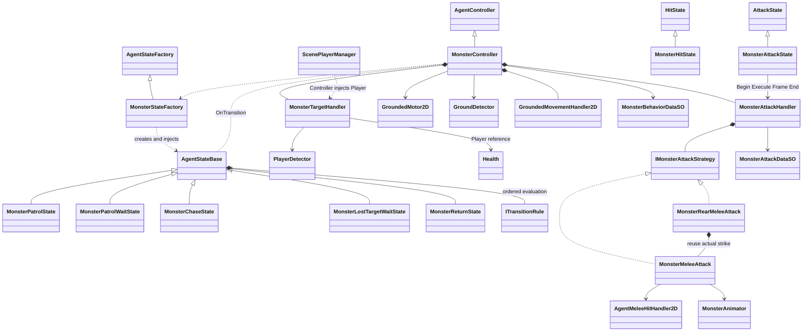

# 지상 Monster FSM — 분리 후 구조

## 1. 변경 요약

대상: 2D 지상 일반 Monster/Goblin. Player의 입력 기반 판단은 유지하고 Monster는 자체 평면 FSM에서 판단·행동을 실행한다. HFSM·Flying·Boss는 구현하지 않았다.

| 이전 | 변경 후 |
|---|---|
| BT → Action → MonsterInput → 네 State FSM | 대상 갱신 → 8개 State FSM → Motor·공격 전략 |
| MonsterController : GroundedAgentController | MonsterController : AgentController, 지상 실행 도구 직접 주입 |
| Context·Handler Inspector 및 StatData 공격 목록 | 행동 SO·공격 SO, Handler의 역할/모션 매핑 |
| 배후 이동 Action 후 공격 요청 | AttackState 내부의 배후 근접 전략 |
| 요청 발행 성공으로 BT 진행 | 실제 공격 준비·공격·종료 결과를 Rule에서 확인 |
| 공격 요청 시각부터 간격 | 정상 공격 모션 종료부터 간격 |
| Agent 공통 Input·근접 타격 검색 | Player·Monster가 필요한 참조만 보유 |

기준선 PDF·[Before 문서](Agent_Separation_Baseline.md)는 변경하지 않았다. State 수 증가는 기존 BT에 있던 판단·대기·복귀를 FSM으로 이전한 결과이며, 코드량·성능 개선 수치는 측정하지 않았다.

## 2. 클래스 관계

기본 Factory의 DeathState와 MonsterHitState는 기존 공통 기반을 재사용한다. Attack·Hit·Death는 기반 Type 키, 독립 판단 State는 각 구체 Type 키를 사용한다. State 상속은 코드 재사용이며 계층 FSM이 아니다.

## 3. 실행·정리

1. Awake: 자기 Component 캐시·Animator·지상 이동 Handler 구성.
2. Start: 대상 Handler·씬 Player 연결 → 개체별 공격 전략 생성 → 현재 X를 HomeX로 Factory 주입 → base.Start의 전환 이벤트 연결 → PatrolWait.
3. Update: 생존·활성·거리·시야·높이 판정 → State의 Rule 순차 평가 → 전이가 없을 때 행동 실행.
4. Chase의 공격 Rule: 간격·거리 충족 전략 중 무작위 선택. Attack Enter에서 실행 시작.
5. 배후 준비는 Grounded 이동 표현. 도착 후 Attack 모션·Preview, Frame에서 기존 근접 타격, End에서 완료·다음 가능 시각 기록.
6. Attack Exit는 이동·모션·Preview 정리. 피격·사망도 동일한 정리 경로 사용.
7. Disable: 현재 State Exit와 대상·이동 정리. Enable: 대상 재주입·행동 재개. 파괴 시 base의 이벤트 해제 유지.

Target은 시야가 맞으면 Root를 유지하고 높이 부적합이면 HasValidTarget만 false다. 범위 밖 Linecast와 지속 갱신 중 Component 검색은 없다. HomeX는 순찰·복귀 목적지이며 추적 제한이 아니다.

Goblin SO:
- GoblinBehaviorData: 반경 2, 순찰 대기 1~2초, 상실 대기 1.5초, 도착 0.15, 높이 1.
- GoblinMeleeAttackData·GoblinRearMeleeAttackData: 피해 2, offset (1.1805878, 0.5690303), size (3.026823, 1.1902943), 시작 거리 1.8, 정상 종료 후 간격 1초, 배후 제한 1.5초.
- 두 전략의 모션값은 1. 기존 Clip·Override·Frame 0·End 시점은 변경하지 않음.

## 4. 사용자 수동 검증

현재 ScenePlayerManager가 실제 Player를 참조하는 InGame을 사용한다. Play 시작·조작은 사용자가 수행한다. Agent는 현재 State·전략 결과·Animator·Console을 읽어 확인하며 강제 입력·타격·위치 변경 코드를 실행하지 않는다.

| 조작·상황 | 기대 결과 |
|---|---|
| Player를 시야 밖에 두고 Play | PatrolWait → Patrol 반복. 처음부터 상실 대기·복귀 없음 |
| Player가 같은 높이의 시야 안으로 이동 | Chase. 초기 위치에서 멀어져도 시야가 유효하면 추적 |
| 공격 거리 진입 후 반복 관찰 | 일반 공격 또는 배후 이동 → 실제 공격. 배후 준비 중 타격 없음 |
| 정상 공격 종료 | 종료 후 1초 동안 추가 공격 시작 없음. 거리 밖이면 Chase |
| 배후 접근 중 시야 이탈 | 정지·1.5초 상실 대기 → Return |
| 대기·복귀 중 재진입 | 즉시 Chase 재개 |
| 공격 모션 중 시야 이탈 | 현재 공격은 완료하고 상황 재판정 |
| 접근·공격 중 Player 공격으로 피격·사망 유발 | Hit/Death 우선, 잔여 이동·Preview 없음, Death End 후 제거 |
| Inspector로 Monster 비활성화·재활성화 | 대상 재연결, HomeX·간격 보존, 중복 실행 없음 |
| Player 이동·Jump·Dash·지상/공중 공격 | 기존 조작·콤보·이벤트·Stamina 유지 |

모든 Play 항목은 아직 미검증이다. Editor에서 컴파일 성공, InGame 전체 Missing Script 0, 실제 Player 연결·필수 참조·전략 2개·Detector/Animator 각 1개, 마지막 수정 이후 새 Console 오류 0을 확인했다. 기존 Editor/Pipeline 오류 로그는 남겨 두었다. 컴파일·참조·수치 확인을 실제 동작 검증으로 간주하지 않는다.
