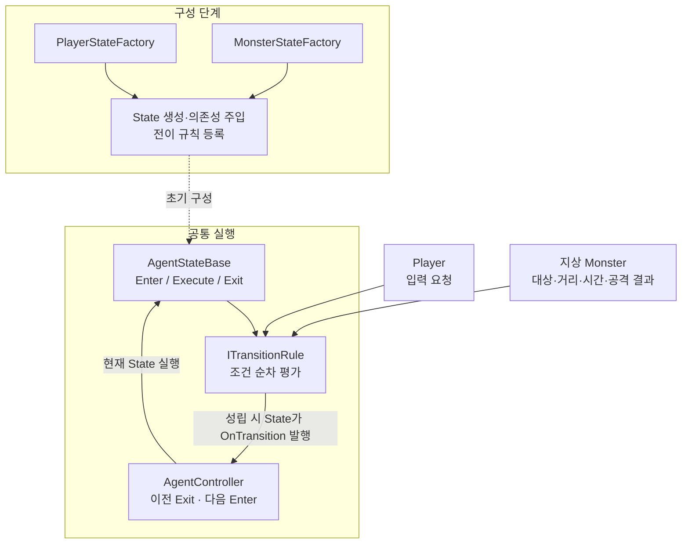
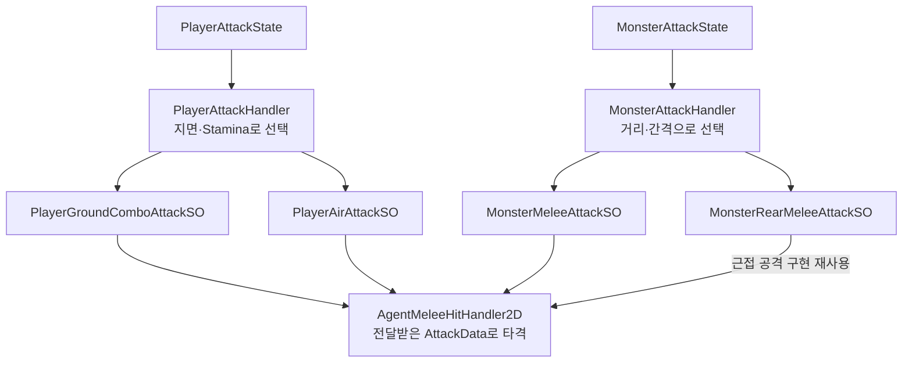

# Project RE 포트폴리오 S16·S17 구성

## 구성 기준

- 교체 범위: 기존 S16 FSM과 S17 Behavior Tree. 전체 18장 구성과 S18 CombatEditor는 유지.
- 결과물: PPT 제작용 구성·문안. 실제 PPT·PDF는 생성하지 않음.
- 메시지: 공통 FSM 실행 기반을 유지하면서 Player 입력 정책과 일반 Monster 판단 정책을 분리하고, 공격을 장착형 SO 전략으로 구성.
- 근거: 현재 `Assets/Scripts/FSM/`와 `Docs/FSM/Refactoring_Log/FSM_Refactoring_Source_Log.md` 4.10·4.11절.
- 시각 스타일: 기존 흰색·연회색 배경, 회청색 제목, 좌측 파란 레일과 상단 구분선 유지. 한 장에 주요 도식 하나와 핵심 문장 3개 이내.
- 최신 공격 SO·Monster FSM은 구현·설정 이전·컴파일 확인 기록이 있으며 전체 Play 회귀는 확인 대기. 성능·GC·제작 시간 개선 수치는 사용하지 않음.

## S16. Agent FSM 구조 개선

### 핵심 메시지

공통 상태 실행은 재사용하고, Player 입력과 Monster의 상황 판단은 각 영역에서 구성.

### 슬라이드 문안

**제목**: Agent FSM 구조 개선

**도식 캡션**: Factory가 State의 의존성과 전이 규칙을 구성하고, Controller가 전환을 실행.

- 초기 Controller 중심 기능 접근을 State별 생성자 주입으로 변경.
- State는 등록된 전이 규칙을 순서대로 평가하고, Controller에 전환 요청을 전달.
- Player는 입력 기반 7개 State, 지상 Monster는 상황 판단 기반 8개 State로 구성.

**하단 요약**: 공통 실행 기반 재사용 · 개체별 판단 정책 분리

### 배치

- 상단: 기존 Project RE 표기와 제목.
- 본문 좌측 약 65%: 아래 관계도. 구성 단계와 실행 단계를 시각적으로 구분.
- 우측 약 35%: 위 핵심 문장과 작은 변경 전 설명 `State가 Controller를 통해 기능 접근·전환`.
- 하단: `리팩토링 과정`은 포트폴리오 Notion, `현재 구조·확장 방법`은 기술 문서 Notion으로 연결. 아이콘에만 의존하지 않고 링크 이름 표시.
- 기존 제네릭 `AgentStateBase<T>` 코드 이미지는 현재 구조의 예시로 사용하지 않음.

### 관계도 원본

화살표는 구성·호출 흐름이며 상속 관계를 뜻하지 않음. Rule 자체에 전환 이벤트가 있는 것으로 표기하지 않음.

### 발표 보충

처음에는 State가 Controller의 기능과 상태 변경 함수를 호출했습니다. Factory가 실제 필요한 참조를 전달하도록 바꾸고 전이 조건을 Rule로 분리했습니다. 일반 Monster는 기존 BT와 입력 중계 계층을 자체 FSM으로 이전해 판단과 실행 결과를 함께 확인합니다. BT의 일반적인 우열이나 State 수 감소를 주장하는 사례는 아닙니다.

## S17. 공격 SO 전략과 확장

### 핵심 메시지

공격 선택과 실행 수명을 Handler에 두고, 공격 수치와 세부 실행은 장착한 SO에서 정의.

### 슬라이드 문안

**제목**: 공격 SO 전략과 확장

**도식 캡션**: State가 공격 수명을 연결하고, Handler가 선택한 개체별 SO 복제본을 실행.

- Player는 지상 콤보·공중 공격, Monster는 일반·배후 공격 SO를 장착.
- 장착 SO를 초기화 때 개체별로 복제하여 실행 상태·구독·타이머를 분리.
- Animation Event에서 단계별 데이터를 공용 근접 타격 Handler에 전달.

**하단 요약**: Handler 선택 · SO 실행 · 공용 타격 계산

### 배치

- 본문 중앙: 아래 공격 관계도. Player와 Monster의 선택 경로를 나란히 표시.
- 아래: 핵심 문장 3개. 작은 코드 캡처나 기존 Behavior Graph·Blackboard 화면은 사용하지 않음.
- 우측 또는 하단에 실제 공격 SO Inspector 캡처 하나를 선택적으로 배치. 캡처는 최신 프로젝트에서 직접 확보하며 가상 화면으로 대체하지 않음.
- S18 CombatEditor가 이어지므로 여기서는 공격 정의·실행 관계만 설명하고 편집 도구 기능은 중복 설명하지 않음.
- 하단 작은 문구: `구현·설정 이전·컴파일 확인 / 최신 Play 회귀 대기`.

### 관계도 원본

공통 하위 SO 계약은 `PlayerAttackSO`와 `MonsterAttackSO`로 분리. 최종 PPT에서 공간이 부족하면 구현 클래스 이름을 `지상 콤보 / 공중 / 일반 / 배후`로 축약하고 Notion에 실제 클래스 관계도를 연결.

### 발표 보충

SO 원본은 설정 에셋으로 보관하고, 실행 참조와 상태는 개체별 복제본에 저장합니다. 기존 종류별 `new` 분기 없이 공격 SO를 장착할 수 있게 했습니다. 기존 공격의 수치 변경·교체는 에셋에서 처리하며, 새로운 공격 동작은 SO 파생 C# 구현과 필요한 Animator 구성이 필요합니다. 코드 없이 임의의 공격을 만들 수 있다고 설명하지 않습니다.

Player 콤보의 연결 순서는 Animator가 담당합니다. FSM은 콤보 전체에서 같은 AttackState를 유지하며 타격 Event의 정수로 1·2·3타 데이터를 선택합니다. Monster 배후 접근은 별도 이동 State가 아닌 공격 SO 내부 준비 단계입니다.

## Notion 상세 문서 연결

- [Agent·FSM 기술 문서](https://app.notion.com/p/FSM-3ed0b1f2783d806a903ee5b8384a9053): 현재 책임·호출 순서·전이·수명·확장 절차.
- [Agent·FSM 리팩토링 포트폴리오](https://app.notion.com/p/FSM-Refactoring-Portfolio-3ed0b1f2783d8085ba55cb6b092e76b2): 초기 문제·선택 이유·변경 결과·검증 범위.

## 주변 슬라이드와 제출 전 확인

- S05 Project RE 기술 목록의 `Behavior`는 현행 Monster 구현으로 오해되지 않도록 `Agent FSM / 공격 SO 전략` 등으로 교체. 기간·플랫폼·개인 작업 표기는 실제 근거를 확인해 유지.
- S06 Maple Rider의 과거 Behavior Tree 학습 이력은 별개이므로 제거하지 않음.
- S18의 구형 `AgentCombatHandler`, `CurrentAttackType` 및 데이터 전용 SO 화면은 현행 `AgentMeleeHitHandler2D`·공격 전략 SO 편집 화면과 대조해 갱신 필요. 실제 PPT 수정은 이번 범위 밖.
- Notion 두 페이지를 로그인하지 않은 브라우저에서 확인. 연결 도구의 편집 성공은 채용 담당자의 공개 열람 가능성을 보장하지 않음.
- 최신 Play 검증을 마친 뒤에만 검증 대기 문구를 실제 결과로 교체. 시연 영상이 이전 구조라면 촬영 기준을 함께 명시.
- Flying·Boss·HFSM·PlayMaker는 구현 성과에 포함하지 않음. 필요 시 별도 후속 계획 또는 조사 자료로 연결.
