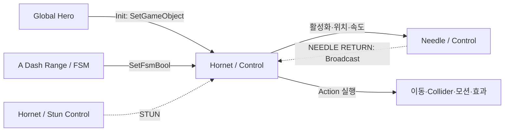

# Hollow Knight 보스 FSM 조사 기록

- 조사일: 2026-10-19
- 결과물: [Hollow_Knight_Boss_FSM_Research.pdf](Hollow_Knight_Boss_FSM_Research.pdf)
- 대표 대상: 호넷 1차전 계열의 `Hornet Boss 1 / Control`
- 추출 자료: `Fungus/Fungus1_04_boss.unity`, 원본 자원 표기 `level133`
- 기준 커밋: `fdac21584342cdaf04f521aa23b36ac71f7a6eea`

## 근거 범위

공식 자료는 적 행동을 PlayMaker FSM으로 제작했다는 사실을 확인한다. 구체적인 호넷 구성은 비공식 공개 FSM 추출본에서 관찰했다. 원작 실행·공식 소스 열람·전체 DLL 분석은 하지 않았으며 추출본의 게임 빌드 번호는 미확인이다.

Control에는 77개 State와 재대결·Godhome 도입 경로가 함께 있다. PDF는 핵심 경로를 선별해 다시 배치한 것으로, 모든 보스의 공통 그래프나 원작 에디터 배치가 아니다. 현재 PlayMaker 문서에는 2의 API도 있으므로 원작 설명은 1 계열 FsmStateAction·OnEnter·OnUpdate·OnExit를 기준으로 구분했다.

## 확인한 구조

| 항목 | 확인 사항 |
| --- | --- |
| 본체 | Control이 초기화·판단·공격 준비/실행/복구·경직 반응을 구성 |
| 보조 FSM | 같은 오브젝트의 Stun Control, 자식 Needle의 Control |
| Player | Init의 SetGameObject가 Global Hero를 로컬 Hero Obj로 전달 |
| 센서 | 자식 A Dash Range의 Trigger 진입/이탈이 부모 Control의 bool을 변경 |
| 실행 | Action이 속도·Collider·모션·효과를 직접 제어. Player 입력 흉내가 아님 |
| 돌진 종료 | 지상은 Wait/측면 충돌, 공중은 저장된 경계 좌표 비교가 관찰됨 |
| 중단 정리 | Stun Start가 바늘·판정 오브젝트 비활성화 및 물리 설정 복구 |
| 바늘 | 별도 이동·복귀 FSM이 NEEDLE RETURN을 Broadcast해 본체 대기 해제 |

여러 FSM의 협력과 HFSM은 동일한 개념이 아니다. Global Transition도 Broadcast 전송 범위와 구분한다. 회복 State가 판정 비활성화·감속·크기 복구를 명시적으로 수행하며, 상태 종료만으로 임의의 설정이 자동 복원되지는 않는다.

## 제한

- 랜덤 Action의 배열이 펼쳐지지 않아 확률·반복 제한 수치는 복원하지 않았다.
- Action 이름만으로 Team Cherry 자체 작성/패키지 확장의 출처를 구분하지 않았다.
- health_manager_enemy·recoil 참조의 실효성과 체력·사망 C# 전체 체인은 별도 확인 대상이다.
- 전체 Component 목록·원본 Inspector·Prefab 편집 과정을 직접 확인하지 않았다.
- 호넷 사례를 모든 보스의 방향 고정·지형 검사 정책으로 일반화하지 않았다.
- PDF의 ReadTargetX는 설명용 예시이며 원작 클래스가 아니다.

## 출처

### 공식 자료

- [Team Cherry 개발 기록](https://www.teamcherry.com.au/blog/inside-the-mind-of-a-bug-unity-and-playmaker)
- [Unity 제작 사례](https://unity.com/made-with-unity/hollow-knight)
- [FSM Component](https://docs.hutonggames.com/components/fsm-component/)
- [Actions](https://docs.hutonggames.com/welcome/core-concepts/actions/)
- [Events](https://docs.hutonggames.com/welcome/core-concepts/events/)
- [Variables](https://docs.hutonggames.com/welcome/core-concepts/variables/)
- [Scene 참조](https://docs.hutonggames.com/guides/referencing-scene-objects/)
- [PlayMaker 1/2 API 구분](https://docs.hutonggames.com/api/upgrade-guide/)

### 공개 관찰 자료

- [Control](https://github.com/windplusflower/hk-api-skill/blob/fdac21584342cdaf04f521aa23b36ac71f7a6eea/fsm-export/Fungus/Fungus1_04_boss.unity/Hornet_Boss_1__Control__fsm_214.md)
- [Stun Control](https://github.com/windplusflower/hk-api-skill/blob/fdac21584342cdaf04f521aa23b36ac71f7a6eea/fsm-export/Fungus/Fungus1_04_boss.unity/Hornet_Boss_1__Stun_Control__fsm_219.md)
- [Needle](https://github.com/windplusflower/hk-api-skill/blob/fdac21584342cdaf04f521aa23b36ac71f7a6eea/fsm-export/Fungus/Fungus1_04_boss.unity/Needle__Control__fsm_227.md)
- [A Dash Range](https://github.com/windplusflower/hk-api-skill/blob/fdac21584342cdaf04f521aa23b36ac71f7a6eea/fsm-export/Fungus/Fungus1_04_boss.unity/A_Dash_Range__FSM__fsm_223.md)
- [DoubleBosses / BossControl.cs](https://github.com/BaikalGit/DoubleBosses/blob/main/BossControl.cs): Hornet1Control은 모드가 추가한 클래스. Godhome 인스턴스의 Control·자식 접근 사례만 교차 확인했다.

현재 프로젝트 비교는 조사일의 AgentStateBase.cs·MonsterAttackHandler.cs를 읽은 적용 시사점이며 원작과 구분했다. 이 문서는 조사 기록이지 구현 계획서가 아니다. 코드·씬·에셋은 변경하지 않았다.
