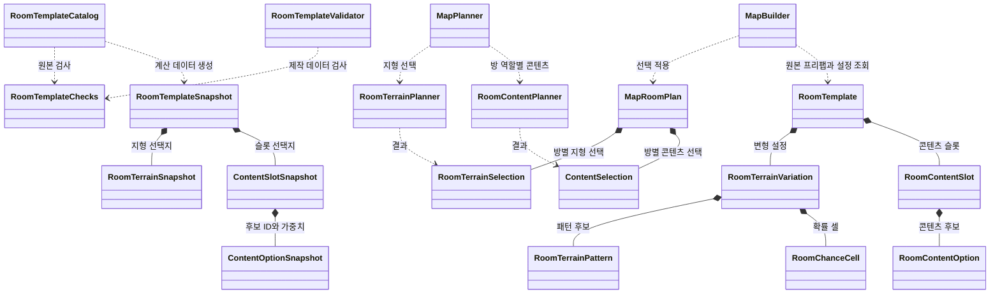

# Chunk 내부 조합 코드 구조

이 문서는 선택된 Chunk의 고정 지형, 변형 패턴·확률 셀과 콘텐츠를 계획하고 적용하는 코드를 설명한다. 실제 출입구·영역·슬롯 작성 방법은 [방 템플릿 제작 규격](Room_Template_Authoring_Guide.md)을, Chunk 간 경로와 연결은 [맵 조합 코드 구조](../../Map_Assembly/Map_Assembly_Code_Guide.md)를 참고한다.

## 현재 구현 범위

`RoomTemplate`은 미리 제작한 기본 방을 보관한다. 생성 시 등록된 변형 영역마다 패턴 하나 또는 빈 패턴을 고르고, 지정된 확률 셀의 타일 채움 여부를 결정한다. 임의의 모든 셀을 자동으로 채우지는 않는다. 콘텐츠는 주 경로의 중간 방과 선택 방에서 최종 방 역할에 맞게 결정한다.

현재 내부 지형 변형은 `sample.horizontal`에서 발판 패턴 또는 빈 패턴과 확률 셀 한 개로 설정·검증했다. `NovaPrototype` 방 14개에는 내부 지형 변형이 설정되지 않았다. 예를 들어 새 선택 방의 콘텐츠는 바뀔 수 있지만 그 방의 고정 지형과 배경은 바뀌지 않는다.

## 클래스 관계

화살표는 호출하거나 사용하는 관계이고 `*--`는 데이터 포함 관계다. 맵 계획과 씬 생성은 내부 선택의 호출·적용 지점으로 표시한다.

## 선택과 적용 순서

1. 제작자는 `RoomTemplate`에 고정 Tilemap, 변형·보호 영역, 패턴 후보, 확률 셀과 콘텐츠 슬롯을 지정한다. 출입구·시작·Goal·선택 방 목표와 검증 표시도 이 원본에 있다.
2. `RoomTemplateCatalog.TryCreateSnapshot()`이 `RoomTemplateChecks`로 원본을 검사하고, 계산에 필요한 ID·확률·가중치를 `RoomTemplateSnapshot`과 내부 스냅샷으로 복사한다. 스냅샷에는 생성할 프리팹 참조를 담지 않는다.
3. `MapPlanner`가 해당 칸의 방을 고르면 `RoomTerrainPlanner.Select()`가 영역별 패턴 ID와 채울 셀을 선택한다. 결과는 `MapRoomPlan.Terrain`에 저장된다. 지형 선택에는 seed, 방 좌표, 템플릿 ID와 영역 인덱스를 사용한다.
4. 경로와 선택 방이 확정되면 `RoomContentPlanner.Select()`가 중간 경로 방과 선택 방의 슬롯별 콘텐츠 ID 또는 빈 선택을 정한다. 일반 방에는 아이템·일반 몬스터, 선택 방에는 아이템·엘리트 몬스터가 허용된다. 시작·Goal과 닫힌 방에는 콘텐츠를 선택하지 않는다. 콘텐츠 난수에는 seed, 방 좌표, 템플릿 ID와 슬롯 인덱스를 사용한다.
5. `MapPlanValidator`가 기록된 지형·콘텐츠 선택을 재계산해 계획과 일치하는지 확인한다. `MapBuilder`는 원본 템플릿에서 ID에 해당하는 패턴·콘텐츠 프리팹을 찾아 배치하고 선택된 확률 셀에 타일을 넣는다.
6. 그래픽 타일이 설정된 경우 `MapVisualBuilder`가 방과 패턴의 충돌 지형을 수집해 맵 전체의 그래픽 Tilemap에 표시한다. RuleTile은 이웃 셀에 따라 그래픽을 고르며 지형의 점유 여부를 결정하지 않는다.

지형·콘텐츠 선택 난수는 주 경로·방 선택과 분리된다. 단, 카탈로그나 템플릿 ID 등의 입력을 변경하면 기존 seed의 결과가 달라질 수 있다.

## 클래스와 소스

| 클래스 | 소스 | 역할 |
| --- | --- | --- |
| `RoomTemplate` | [RoomTemplate.cs](../../../../Assets/Scripts/Map/RoomTemplates/RoomTemplate.cs) | 방 ID·유형·출입구·통과 방향, 고정 Tilemap, 변형 영역, 슬롯과 마커를 보관한다. `OpeningCells()`가 출입구 셀의 기준이다. |
| `RoomType`, `RoomOpening`, `RoomPassage` | [RoomTemplate.cs](../../../../Assets/Scripts/Map/RoomTemplates/RoomTemplate.cs) | 방 유형·출입구 방향·진입→진출 후보를 표현한다. |
| `RoomTerrainVariation`, `RoomTerrainPattern`, `RoomChanceCell` | [RoomTemplate.cs](../../../../Assets/Scripts/Map/RoomTemplates/RoomTemplate.cs) | 변형 영역의 패턴 후보와 확률 셀·검증 표시를 보관한다. |
| `RoomContentSlot`, `RoomContentOption`, `ContentKind`, `ContentRoomRole` | [RoomContent.cs](../../../../Assets/Scripts/Map/RoomTemplates/RoomContent.cs) | 슬롯의 공간·설치면·방향, 후보 종류·가중치와 방 역할을 정의한다. |
| `RoomTemplateChecks` | [RoomTemplateChecks.cs](../../../../Assets/Scripts/Map/RoomTemplates/RoomTemplateChecks.cs) | 원본의 지형·경계·마커·변형 및 슬롯 규격을 검사한다. |
| `RoomTemplateValidator` | [RoomTemplateValidator.cs](../../../../Assets/Editor/MapGenerator/RoomTemplates/RoomTemplateValidator.cs) | 에디터 메뉴에서 선택한 방의 제작 데이터를 검사한다. |
| `RoomTemplateCatalog`, `RoomTemplateSnapshot` | [RoomTemplateCatalog.cs](../../../../Assets/Scripts/Map/RoomTemplates/RoomTemplateCatalog.cs), [RoomTemplateSnapshot.cs](../../../../Assets/Scripts/Map/RoomTemplates/RoomTemplateSnapshot.cs) | 프리팹 목록을 검사하고 계산용 방 데이터를 만든다. |
| `RoomTerrainSnapshot`, `RoomTerrainPlanner`, `RoomTerrainSelection` | [RoomTerrainPlan.cs](../../../../Assets/Scripts/Map/RoomTemplates/RoomTerrainPlan.cs) | 지형 선택지의 복사본, 선택 계산과 확정된 패턴·셀을 담당한다. |
| `ContentOptionSnapshot`, `ContentSlotSnapshot`, `RoomContentPlanner`, `ContentSelection` | [RoomContent.cs](../../../../Assets/Scripts/Map/RoomTemplates/RoomContent.cs) | 콘텐츠 선택지의 복사본, 가중치 계산과 확정된 슬롯 결과를 담당한다. |
| `MapPlanner`, `MapRoomPlan`, `MapPlanValidator` | [MapPlanner.cs](../../../../Assets/Scripts/Map/RoomTemplates/MapPlanner.cs), [MapPlan.cs](../../../../Assets/Scripts/Map/RoomTemplates/MapPlan.cs), [MapPlanValidator.cs](../../../../Assets/Scripts/Map/RoomTemplates/MapPlanValidator.cs) | 내부 선택을 요청·기록하고 완성 계획을 검증한다. |
| `MapBuilder`, `MapVisualBuilder` | [MapBuilder.cs](../../../../Assets/Scripts/Map/RoomTemplates/MapBuilder.cs), [MapVisualBuilder.cs](../../../../Assets/Scripts/Map/RoomTemplates/MapVisualBuilder.cs) | 확정된 내부 선택을 생성하고 선택적 공통 지형 그래픽을 만든다. |

## 검증과 코드 읽는 순서

1. `RoomTemplate`의 고정 지형·변형과 콘텐츠 필드, `RoomTemplateChecks.Validate()`를 읽는다.
2. `RoomTemplateCatalog.TryCreateSnapshot()`에서 원본의 어떤 값을 복사하는지 확인한다.
3. `MapPlanner.TrySelect()`와 `AddOptionalRoom()`에서 지형과 콘텐츠 선택을 요청하는 지점을 찾는다. 각 선택의 난수 계산과 결과는 `RoomTerrainPlanner`와 `RoomContentPlanner`에서 확인한다.
4. `MapBuilder.Build()`에서 패턴 프리팹·확률 셀·콘텐츠 프리팹을 적용하는 부분을 읽는다. 그래픽과 Collider의 분리는 `MapVisualBuilder`에서 확인한다.
5. [RoomTerrainTests.cs](../../../../Assets/Tests/EditMode/MapGeneration/RoomTerrainTests.cs), [OptionalRoomTests.cs](../../../../Assets/Tests/EditMode/MapGeneration/OptionalRoomTests.cs), [MapVisualBuilderTests.cs](../../../../Assets/Tests/EditMode/MapGeneration/MapVisualBuilderTests.cs)를 참고한다.

`Passages Verified`, `Combinations Verified`와 시작·Goal·왕복 방향은 실제 Player로 확인한 뒤 제작자가 기록한다. 지형이나 관련 조건을 변경해도 표시가 자동 해제되지 않으며, 정적 검사만으로 Player 통과가 보장되지는 않는다.
