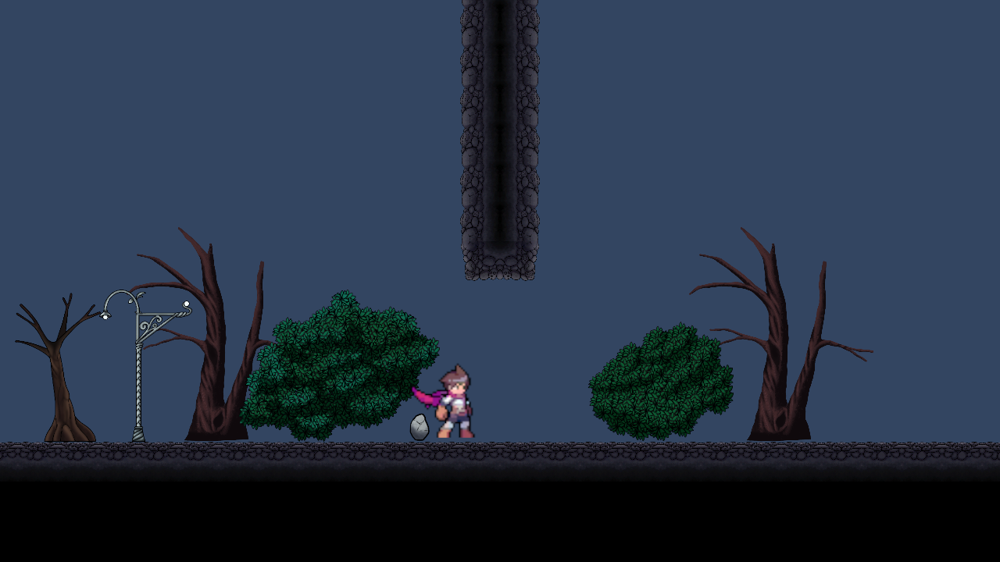

# 방 지형·배경·장식 제작 규칙

방의 이동 지형을 먼저 확정한 뒤 NovaDevs 에셋으로 배경과 장식을 배치한다. 방 크기·출입구·통과 검증은 [방 템플릿 제작 규격](Room_Template_Authoring_Guide.md), 지형 그래픽의 생성 방식은 [NovaDevs 배치 설계안](NovaDevs_Level_Art_Design.md)을 따른다.

예시는 인접한 두 `Horizontal` 방의 지형, 나무·수풀·돌·가로등과 Player Sprite를 임시 씬에 배치한 화면이다. 파란 바탕은 프리뷰 카메라의 확인용 색상이다. 실제 방 프리팹에 장식이 저장된 결과는 아니다.

## 제작 순서

1. 사용할 배경·장식·상호작용 오브젝트가 데모에서 어떻게 배치되는지 실제 화면과 계층에서 확인하고 방의 장소 주제를 정한다.
2. 20×20 셀의 고정 지형과 출입구를 만들고, 실제 Player가 필요한 경로와 착지 지점을 통과하는지 확인한다.
3. 패턴·확률 셀을 사용할 경우 변형 영역과 보호 영역을 설정하고 각 조합의 이동 가능성을 확인한다.
4. 지형은 `FixedGeometry`와 패턴의 Grid 충돌 타일로 기록한다. 맵 설정에 그래픽 RuleTile을 지정하면 생성 시 확정된 지형을 공통 그래픽 Tilemap에 표시한다.
5. 방별 주제에 맞춰 배경과 장식을 수동으로 배치하고, Player 크기·카메라 범위와 인접 방 및 지형 변형에서 보이는 모양을 확인한다.
6. 통과 검증 표시와 카탈로그 등록은 [방 템플릿 제작 규격](Room_Template_Authoring_Guide.md)의 검사 및 실제 이동 결과를 기준으로 한다.

## 지형과 출입구

- 고정 지형·패턴·확률 셀은 실제 충돌을 담당한다. 시각 지형 RuleTile은 생성된 맵 전체에서 이웃을 판정하며 Collider를 추가하지 않는다. 그래픽을 따로 그려 충돌 셀의 유무를 바꾸지 않는다.
- 열린 출입구는 서·동 `y=4~7`, 남·북 `x=13~16`이다. 연결부와 착지 지점의 충돌 지형을 규격대로 유지하고, 지형 모양이 Player의 실제 충돌 면과 어긋나 보이지 않는지 확인한다.
- 패턴은 선택 여부에 따라 주변 지형이 달라진다. 빈 패턴과 각 패턴·확률 셀 조합에서 공통 그래픽 Tilemap의 경계와 안쪽 모서리를 확인한다.
- 방 프리팹의 장식은 방과 함께 생성되지만 서로 다른 방의 장식을 잘라 주는 기능은 없다. 경계 밖으로 나가는 Sprite는 이웃 방의 출입구·지형과 겹칠 수 있으므로 연결 결과를 확인한다.

## 배경과 장식

| 대상 | 배치 방법 | 확인할 점 |
| --- | --- | --- |
| [Trees](../../../../Assets/@tempAssets/NovaDevs/2D%20Platformer%20-%20Skull%20Garden%20%20Tilesets%20Asset%20Pack/Trees/) | 방의 자식 SpriteRenderer로 수동 배치 | 나무 밑부분을 지면에 맞추고 화면 위쪽과 방 경계에서 잘리거나 반복되는 모습이 어색하지 않은지 확인한다. |
| [Bushes](../../../../Assets/@tempAssets/NovaDevs/2D%20Platformer%20-%20Skull%20Garden%20%20Tilesets%20Asset%20Pack/Bushes/)·[Rocks](../../../../Assets/@tempAssets/NovaDevs/2D%20Platformer%20-%20Skull%20Garden%20%20Tilesets%20Asset%20Pack/Rocks/) | 바닥 주변에 SpriteRenderer로 수동 배치 | 실제 Sprite 크기와 피벗을 확인한다. 출입구·착지 지점·콘텐츠가 읽히도록 크기와 위치를 조절한다. |
| [Architecture·Prefabs](../../../../Assets/@tempAssets/NovaDevs/2D%20Platformer%20-%20Skull%20Garden%20%20Tilesets%20Asset%20Pack/Prefabs/) | 가로등·사당·아치 등을 프리팹으로 배치 | 자식 Renderer의 정렬, 조명·파티클, Collider와 실제 지면 기준점을 확인한다. |

장식은 기본적으로 물리 충돌을 추가하지 않는다. 프리팹에 Collider가 있는 경우 역할과 이동 영향을 확인하고, 물리 장애물로 사용할 때는 방 지형 변경과 동일하게 통과를 다시 검증한다. Player·몬스터·아이템·Goal과 출입구를 가리거나 플레이어가 빈 공간으로 오해할 그림은 피한다.

숲 방은 수관·줄기·하층 수풀처럼 서로 다른 높이와 깊이를 조합한다. 건축물 방은 아치·조형물·받침 등으로 중심과 주변 요소를 구분한다. 같은 오브젝트를 일정 간격으로 배치한 결과가 기계적으로 보이지 않는지 살피고, 주제마다 장식 밀도와 형태를 달리한다. 상호작용 오브젝트는 데모에서 시각적 맥락을 확인한 뒤 실제 기능과 Collider, 접근 공간을 별도로 검증한다.

Sprite의 Transform 원점이 발밑에 있다는 보장은 없다. 나무·수풀·건축물의 받침은 바닥에 살짝 겹치도록 배치한다. 현재 Nova Variant는 Sprite Renderer 아래쪽이 바닥보다 약 0.1유닛 낮도록 맞췄으며, Sprite의 투명 영역을 감안해 실제 화면도 확인한다. 프리팹은 실제 받침 Renderer를 기준으로 맞춘다. 예를 들어 NovaDevs `LampPost`는 루트 원점과 `LampPostBase_0`가 떨어져 있으므로 루트를 바닥 좌표에 놓는 것만으로는 지면 정렬이 되지 않는다.

Base의 바닥 높이가 다른 방에 기존 장식을 옮길 때는 장식의 이전 좌표를 그대로 신뢰하지 않는다. 현재 고정 지형의 지지면과 실제 표시 모양을 대조하고, 사당처럼 받침 위에 여러 Sprite가 쌓인 경우 받침을 기준으로 상대 배치를 유지해 조정한다. 바닥에 놓이는 장식은 관련 지형 변형과 생성 화면에서도 확인한다.

`Protected Regions`, 콘텐츠 슬롯과 출입구는 실제 통로·착지·상호작용을 위한 공간이다. 배경은 이 공간 뒤에 표시할 수 있으나 캐릭터나 콘텐츠를 시각적으로 가리지 않도록 확인한다. 장식 Sprite의 겹침과 화면 가독성은 현재 정적 검사기가 자동 검증하지 않으므로 제작자가 확인한다.

## 표시 순서

다음은 현재 `Terrain Visual`이 `Default` 정렬 레이어, Order `0`을 사용하는 경우의 기준이다. 같은 레이어에서는 숫자가 작을수록 뒤에 표시된다.

| 역할 | Sorting Layer | Order 예시 |
| --- | --- | --- |
| 먼 나무·배경 | `Default` | `-30` |
| 가까운 배경 나무 | `Default` | `-20` |
| 지형 뒤 수풀·구조물 | `Default` | `-10` |
| 공통 지형 그래픽 | `Default` | `0` |
| 지형 앞 장식 | `Default` | `5` 부근 |
| Player·Goblin Sprite | `Player` | 현재 프리팹 기준 `0` |

현재 `Player` 레이어는 `Default`보다 앞이므로 `Default` 장식의 Order를 높여도 Player 앞에 오지 않는다. 여러 Renderer로 구성된 프리팹은 각 자식의 기존 Order 차이를 유지한 채 같은 값을 더한다. 조명은 대상 Sorting Layer가 바뀌면 영향 범위가 달라질 수 있으므로 함께 확인한다.

현재 프로젝트에서 `BG_Far`와 `BG_Mid`는 `Default`보다 앞에 정렬된다. 이름만 보고 공통 지형 뒤에 배치할 수 있다고 가정하지 않는다. `Deco`와 `FG`는 프로젝트 설정에 이름이 있으나 현재 Unity 조회에서 둘 다 ID `0`인 `Default`로 확인되어 별도 레이어로 사용하지 않는다. 정렬 레이어를 변경할 때는 Player·몬스터·기존 장식과 2D 조명의 결과를 함께 검증한다.

## 확인 기준

- 고정 지형과 패턴의 그래픽이 방 경계에서 이어지고 열린 출입구를 가리지 않는다.
- 배경·장식은 표시 순서와 크기가 의도에 맞으며 Player, 몬스터, 아이템과 Goal이 식별된다. 가로등 등 복합 프리팹은 바닥 기준점, 자식 정렬과 조명을 확인한다.
- 서로 다른 방과 패턴 조합에서 Sprite가 원하지 않는 방 영역을 침범하거나 통로를 시각적으로 막지 않는지 확인한다.
- 지형·Collider·통로를 변경한 경우 관련 검증 표시를 해제하고 해당 방향과 조합을 실제 Player로 다시 확인한다. 순수 시각 장식은 정렬·가독성과 Collider 유무를 확인한다.
