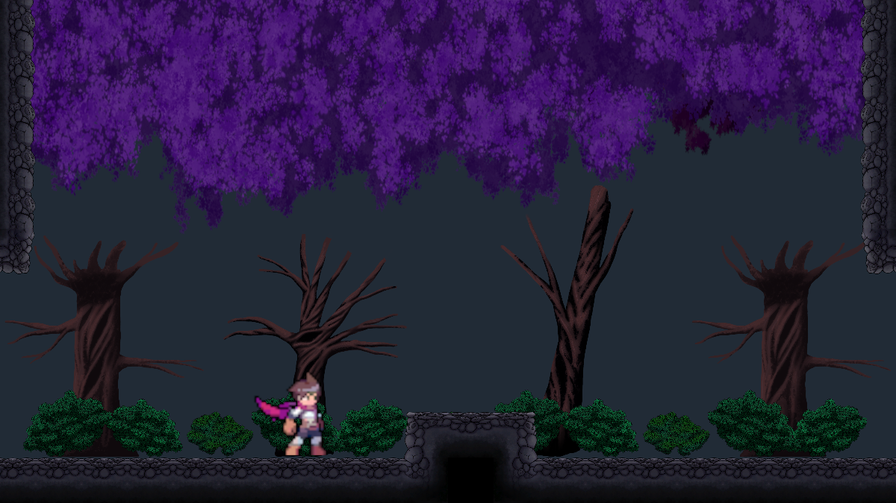

# 방 템플릿 제작 규격

내부 패턴·확률 셀·콘텐츠의 코드 흐름은 [Chunk 내부 조합 코드 구조](Chunk_Generation_Code_Guide.md)를 참고한다. 지형 그래픽과 배경·장식의 구체적인 배치 및 정렬 기준은 [방 지형·배경·장식 제작 규칙](Room_Art_Authoring_Guide.md)을 따른다.

`NovaPrototype`의 시제품은 독립 프리팹이다. 기본 카탈로그에는 시제품에 대응하는 Base 상속 방과 닫힌 방·분기용 `NovaVariants`가 등록돼 있다. 검증 범위는 [진행 현황](../Chunk_Generation_Progress.md)을 따른다.

## 기본 구성

- 방 크기는 20×20 Unity 단위, Grid 셀은 1×1이다. 루트의 기준점은 왼쪽 아래이며 회전 0, 스케일 1이다.
- 루트에는 `Grid`와 `RoomTemplate`을 둔다. `FixedGeometry`는 루트 바로 아래에 위치 0·회전 0·스케일 1의 Tilemap으로 두고 지형 Collider를 연결한다.
- `RoomTemplate`은 ID, 방 유형, 열린 출입구, 진입→진출 후보, 변형·보호 영역, 콘텐츠 슬롯과 Player 시작·Goal 마커를 기록한다.
- 방 유형은 출입구의 역할을 나타낸다. `Side`는 출입구가 없고, `Horizontal`은 동·서 중 하나 이상, `Down`은 남쪽, `Arrival`은 북쪽이 열려 있어야 한다. `Arrival`에는 남쪽 출입구를 지정하지 않는다.

## 출입구와 이동 기준

좌표는 방 내부의 타일 셀이다. 출입구의 폭은 네 셀이다.

| 방향 | 경계 셀 | 월드 경계의 중심 |
| --- | --- | --- |
| 서 | x=0, y=4~7 | (0, 6) |
| 동 | x=19, y=4~7 | (20, 6) |
| 남 | x=13~16, y=0 | (15, 0) |
| 북 | x=13~16, y=19 | (15, 20) |

`RoomTemplate.OpeningCells()`가 경계 셀의 기준이다. 열린 출입구는 고정 지형을 비우고, 나머지 경계는 고정 지형으로 닫는다. 맞닿는 방은 같은 위치·폭을 사용한다. 실제 이동을 위해 문 안쪽의 몸통 공간과 착지면도 확보한다.

현재 `ProjectRE_Player Variant`의 CapsuleCollider2D는 1×1.9, 무게 1, 중력 배율 1이다. PlayerMotorData는 지상 이동 5, 공중 이동 4, 점프 힘 8, 수평 대쉬 거리 5, 공중 대쉬 1회를 사용한다. 지면 감지는 `Ground` 레이어를 사용한다. 물리 계산상 수치와 실제 조작 결과는 차이가 있을 수 있으므로 점프 거리·착지·벽 충돌은 실제 Player로 확인한다.

`Passages`는 제작자가 지정한 통과 방향 후보이며 방향별로 별도 기록한다. `Passages Verified`는 **기록한 모든 방향을 실제 Player로 확인한 뒤에만** 켠다. 정적 검사 통과가 이동 성공을 보증하지는 않는다.

`Verified Start Exits`는 시작 마커에서 도달할 수 있는 출입구, `Verified Goal Entries`는 Goal 마커에 도달할 수 있는 진입구를 기록한다. 마커의 존재와 경로 검증은 별도다.

막다른 선택 방에는 `Optional Target`을 지정하고 해당 출입구에서 목표까지 이동한 뒤 같은 출입구로 돌아올 수 있음을 확인한다. 실제 왕복을 확인한 방향만 `Verified Dead End Returns`에 기록한다.

지형·Collider·출입구·통과 방향·마커를 수정하면 검증 결과가 무효다. 관련 `Passages Verified`, 마커 검증 방향과 `Verified Dead End Returns`를 직접 지우고 해당 방향을 다시 확인한다.

## 변형과 콘텐츠 마커

- `Variation Regions`는 내부 패턴과 확률 셀을 적용할 영역이다. 방 경계와 떨어뜨리고 서로 겹치지 않게 둔다. 사용 중인 영역에는 고정 지형이 없어야 한다.
- `Protected Regions`는 필수 통로·착지면 주변에서 변형을 금지할 영역이다. 변형 영역과 겹치지 않아야 한다. 영역 위치가 실제 이동을 보장하는지는 제작자가 확인한다.
- `Terrain Variations`에서 변형 영역의 인덱스, 빈 패턴 허용 여부, 패턴 ID와 프리팹, 확률 셀의 방 내부 좌표·타일·확률(0~100)을 지정한다. 패턴은 영역의 왼쪽 아래를 기준으로 배치되며, 서로 다른 패턴은 같은 영역의 대안이다. 패턴의 타일은 영역 밖이나 확률 셀과 겹칠 수 없다.
- 패턴 프리팹은 셀 크기 1인 Grid 루트와 위치·회전 0, 크기 1인 단일 자식 Tilemap 및 활성 TilemapCollider2D로 구성한다. Tilemap은 고정 지형과 같은 레이어를 사용하며, Collider는 그 Tilemap의 TilemapCollider2D와 CompositeCollider2D만 허용한다. 타일 좌표는 영역의 왼쪽 아래를 `(0,0)`으로 사용한다.
- `Combinations Verified`는 해당 방에서 패턴과 확률 셀의 모든 조합을 실제 Player의 기록된 각 통과 방향과 시작·Goal 연결에 대해 확인한 뒤 켠다. 검증되지 않은 설정은 카탈로그 검사에서 실패한다. 패턴, 확률 셀, 지형, 통로 또는 보호 영역을 수정하면 이 표시를 지우고 다시 확인한다. 표시는 자동으로 해제되지 않는다.
- `Content Slots`에 기준 셀을 넣고 `Content Settings`에 슬롯 인덱스, 충돌 여유 공간(`Clearance`), 설치면, 좌우 방향과 선택지를 지정한다. 선택지는 ID, 프리팹, 양의 가중치, 기준 셀의 `(x+0.5, y)`에서의 위치 오프셋을 가진다. `Empty Weight`는 아무것도 배치하지 않을 가중치다.
- 콘텐츠의 루트에는 활성 BoxCollider2D 또는 CapsuleCollider2D 하나가 필요하다. 지정된 방향의 Collider가 여유 공간 안에 들어가고 설치면에 닿아야 한다. 지지면은 전체 셀이 충돌하는 Grid 타입 타일이어야 하며, 여유 공간·지지면은 변형 영역과 겹치지 않는다. 여유 공간은 고정 지형·다른 슬롯·보호 영역·출입구와 겹치지 않는다.
- 콘텐츠는 최종 역할이 중간 경로 방 또는 선택 방인 경우에만 생성한다. 슬롯 후보에 종류를 지정하면 일반 방은 아이템·일반 몬스터, 선택 방은 아이템·엘리트 몬스터와 빈 상태를 선택한다. 몬스터의 이동과 추적은 해당 FSM이 담당하므로 생성 이후에는 슬롯 영역 밖으로 이동할 수 있다.
- `Player Start`와 `Goal`은 서로 독립된 위치 마커다. 마커 자체가 Player나 GoalTrigger를 생성하지 않는다.
- 프리팹을 선택하면 Scene 뷰에서 회색 방 경계, 초록색 출입구, 청록색 변형 영역, 빨간색 보호 영역, 노란색 콘텐츠 슬롯을 확인할 수 있다.

현재 `sample.horizontal`과 이를 상속하는 가로 Variant는 `(3,10)`의 변형 영역에 `Legacy_EW1_Platform` 또는 빈 패턴을 선택하고 `(3,12)` 셀을 50% 확률로 채운다. Base의 네 조합에 대한 서→동·동→서 통과를 실제 Player로 확인했다. 다른 Base에는 아직 지형 변형이 설정되지 않았다.

## 샘플과 검사

`Assets/Prefabs/Map/RoomTemplates/Base/`에 유형별 기본 샘플과 연속 하강용 `DownThrough` 샘플이 있다. 단색 Tile은 규격을 확인하기 위한 임시 지형 표현이다.

실제 Player와 Input System 가상 입력으로 기록된 17개 통과 방향을 확인했다. `Horizontal` 2개, `Down` 4개, `DownThrough` 7개, `Arrival` 4개가 통과해 네 샘플의 `Passages Verified`를 활성화했다. `Side`는 닫힌 채움 방으로 통과 방향이 없다. `RoomTemplateMovementSample`에서는 연속 하강과 착지도 확인했다.

`Assets/Prefabs/Map/RoomTemplates/Base/`에는 외곽과 시작·Goal에 맞춰 출입구를 닫은 변형 9개가 있다. 시작 마커→출입구 3개, 출입구→Goal 마커 3개와 나머지 방의 통과 방향 5개를 실제 Player로 확인했다.

`CapWest`, `CapEast`는 출입구에서 내부 목표 지점까지 왕복을 확인했다. 실제 Run에서 Goblin의 Player 인식과 아이템 획득, 선택 방에서 주 경로로 돌아와 하강하는 동작을 확인했다.

### Nova 시제품 방

아래는 독립 시제품의 지형과 당시 검증 기록이다. 현재 생성되는 방은 Base를 상속한 `NovaVariants`이며 시제품과 지형·seed별 배치가 다를 수 있다. 현재 설정과 검증 범위는 [진행 현황](../Chunk_Generation_Progress.md)을 따른다.

[Start_ForestGateway](../../../../Assets/Prefabs/Map/RoomTemplates/NovaPrototype/Start_ForestGateway.prefab)은 동쪽 출구를 가진 시작 전용 방이다. Demo 1·2의 숲과 아치를 참고해 시작 위치 주변을 구성했다. 실제 Player가 시작 마커에서 생성된 뒤 단차를 넘어 동쪽 이웃 방에 진입하는 것을 확인했다. Goal·선택 방 마커와 내부 랜덤 패턴은 없다.

[Start_ShrineWest](../../../../Assets/Prefabs/Map/RoomTemplates/NovaPrototype/Start_ShrineWest.prefab)는 서쪽 출구를 가진 시작 전용 방이다. Demo 2의 사당 조형물과 아치를 참고해 배경을 구성했다. 실제 Player가 시작 마커에서 단차를 넘어 서쪽 이웃 방에 진입하고 착지하는 것을 확인했다. Goal·선택 방 마커와 내부 랜덤 패턴은 없다.

[Start_ForestDrop](../../../../Assets/Prefabs/Map/RoomTemplates/NovaPrototype/Start_ForestDrop.prefab)은 남쪽 출구를 가진 시작 전용 방이다. Demo 1의 숲과 울타리를 참고해 배경을 구성했다. 실제 Player가 시작 마커에서 단차를 넘어 아래 방의 발판에 착지하는 것을 확인했다. Goal·선택 방 마커와 내부 랜덤 패턴은 없다.

[Goal_RuinedSanctuary](../../../../Assets/Prefabs/Map/RoomTemplates/NovaPrototype/Goal_RuinedSanctuary.prefab)는 서쪽 진입구를 가진 도착 전용 방이다. Demo 2의 숲과 아치를 참고해 Goal 주변을 구성했다. 실제 Player가 서쪽 이웃 방에서 진입해 Goal 트리거에 접촉하는 것을 확인했다. 시작·선택 방 마커와 내부 랜덤 패턴은 없다.

[Goal_ForestDescent](../../../../Assets/Prefabs/Map/RoomTemplates/NovaPrototype/Goal_ForestDescent.prefab)는 북쪽 진입구와 중간 착지 발판을 가진 도착 전용 방이다. Demo 3의 수관과 하층 식생에 폐허 조형물을 더했다. 실제 Player가 위쪽 방에서 발판으로 내려와 Goal 트리거에 접촉한 뒤 바닥에 착지하는 것을 확인했다. 시작·선택 방 마커와 내부 랜덤 패턴은 없다.

[Goal_OvergrownCourt](../../../../Assets/Prefabs/Map/RoomTemplates/NovaPrototype/Goal_OvergrownCourt.prefab)는 동쪽 진입구와 낮은 단차를 가진 도착 전용 방이다. Demo 1의 울타리와 나무를 참고해 폐허 정원을 구성했다. 실제 Player가 동쪽 이웃 방에서 진입해 단차를 넘고 Goal 트리거에 접촉하는 것을 확인했다. 시작·선택 방 마커와 내부 랜덤 패턴은 없다.

[Optional_RuinedCourt](../../../../Assets/Prefabs/Map/RoomTemplates/NovaPrototype/Optional_RuinedCourt.prefab)는 서쪽 입구와 콘텐츠 슬롯을 가진 막다른 선택 방이다. Demo 1의 나무·울타리와 폐허 조형물을 참고했다. 현재 선택 방에는 아이템 또는 빈 상태가 선택된다. Base를 상속한 [Nova Variant](../../../../Assets/Prefabs/Map/RoomTemplates/NovaVariants/Optional_RuinedCourt.prefab)는 생성 맵에서 실제 Player가 아이템을 획득하고 서쪽으로 복귀하는 것을 확인했다.

[Horizontal_Step](../../../../Assets/Prefabs/Map/RoomTemplates/NovaPrototype/Horizontal_Step.prefab)은 중앙에 세 셀 폭의 한 단 지형과 수관·나무·하층 수풀로 구성한 숲 배경을 가진 좌우 통로 방이다. 서→동과 동→서 통과를 실제 Player의 이동·점프로 확인했다. 시작·Goal 마커의 연결 방향은 검증하지 않았으므로 시작·Goal 방으로 사용하지 않는다. 내부 랜덤 패턴은 설정하지 않았다.

[Horizontal_Shrine](../../../../Assets/Prefabs/Map/RoomTemplates/NovaPrototype/Horizontal_Shrine.prefab)은 같은 지형과 통과 조건을 사용하는 사당 테마 방이다. Demo 2의 아치·조형물·받침 배치를 참고했으며 조형물은 상호작용 기능이 없는 배경 Sprite다. 숲 방과 지형 타일·Collider·통과 방향이 같은지 비교하고 장식에 Collider가 없음을 확인했다. 실제 Player로 서→동, 동→서 점프 통과와 마지막 착지를 확인했다.

[Down_ForestStep](../../../../Assets/Prefabs/Map/RoomTemplates/NovaPrototype/Down_ForestStep.prefab)은 서쪽으로 진입해 중앙 단차를 넘고 남쪽으로 하강하는 숲 방이다. 통과 방향은 서→남 한 가지다. 실제 Player가 점프해 단차를 넘고 남쪽 출입구를 통과해 아래 방에 착지한 것을 확인했다. 시작·Goal 마커와 내부 랜덤 패턴은 없다.

[Arrival_RuinedGallery](../../../../Assets/Prefabs/Map/RoomTemplates/NovaPrototype/Arrival_RuinedGallery.prefab)는 북쪽에서 내려와 중간 발판에 착지하고 서쪽으로 이동하는 폐허 회랑 방이다. Demo 1·2의 사당 조형물을 참고해 부서진 기둥과 수풀을 배치했다. 통과 방향은 북→서 한 가지이며 실제 Player의 발판 착지와 서쪽 방 진입을 확인했다. 시작·Goal 마커와 내부 랜덤 패턴은 없다.

[Arrival_ShrineAtrium](../../../../Assets/Prefabs/Map/RoomTemplates/NovaPrototype/Arrival_ShrineAtrium.prefab)은 북쪽에서 내려와 중간 발판에 착지하고 동쪽으로 이동하는 방이다. Demo 2의 아치와 조형물 배치를 참고해 사당 배경을 구성했다. 실제 Player가 위쪽 방에서 내려와 발판에 착지한 뒤 동쪽 방으로 이동하는 것을 확인했다. 시작·Goal 마커와 내부 랜덤 패턴은 없다.

[Down_RuinedOverlook](../../../../Assets/Prefabs/Map/RoomTemplates/NovaPrototype/Down_RuinedOverlook.prefab)은 동쪽으로 진입해 단차를 넘고 남쪽으로 하강하는 방이다. Demo 2·3의 숲과 난간을 참고해 수관·나무·수풀과 부서진 기둥으로 전망대 배경을 구성했다. 실제 Player로 동→남 점프·하강과 아래 발판 착지를 확인했다. 시작·Goal 마커와 내부 랜덤 패턴은 없다.

[DownThrough_RuinedShaft](../../../../Assets/Prefabs/Map/RoomTemplates/NovaPrototype/DownThrough_RuinedShaft.prefab)은 북쪽 발판에 착지한 뒤 오른쪽으로 내려와 남쪽 출입구로 이동하는 연속 하강 방이다. Demo 1·3을 참고해 수관과 폐허 조형물·아치를 배치했다. 실제 Player로 북→남 이동과 아래 발판 착지를 확인했다. 시작·Goal 마커와 내부 랜덤 패턴은 없다.

[기본 설정](../../../../Assets/Prefabs/@Data/Map/MapPlanningSettings.asset)은 Nova Variant 카탈로그와 지형 RuleTile을 사용한다. 아래 이미지는 이전 시제품 설정으로 생성한 참고 화면이다.

이미지는 생성된 맵과 실제 Player 프리팹의 정지 자세를 임시 프리뷰 카메라로 렌더링한 결과다. 배경색과 조명은 확인용이다. 지형의 어두운 내부 표현과 다른 방 유형과의 조합은 추가 확인이 필요하다.

시제품 설정의 seed `14`에서는 숲 방 `(1, 3)`과 사당 방 `(2, 3)`이 인접한다. [사당 방 화면](Images/ShrineRoomGenerated.png)과 [두 방의 연결 화면](Images/ForestShrineBoundary.png)은 이전 카탈로그로 생성한 두 방을 Player 정지 자세와 함께 임시 카메라로 렌더링한 예시다.

시제품 설정의 seed `0`에서는 하강 방 `(3, 0)` 아래에 폐허 회랑 `(3, 1)`이 연결된다. [하강 방 화면](Images/DownForestRoom.png), [폐허 회랑 화면](Images/ArrivalGalleryRoom.png), [하강 연결 화면](Images/DownForestConnection.png)은 생성된 맵과 Player 정지 자세를 임시 카메라로 렌더링한 결과다.

같은 seed의 하강 방에서 실제 Player와 카메라 프리팹으로 점프·하강해 회랑 중간 발판에 착지했다. 지형 머티리얼 적용 후 [단차 화면](Images/PlayerCameraStepAdjusted.png)과 [착지 화면](Images/PlayerCameraLandingAdjusted.png)은 Play 모드의 카메라 출력이다. 검증에는 임시 씬과 전역 조명을 사용했으며 전체 게임 시작 흐름과 다른 조명은 확인하지 않았다.

시제품 설정의 seed `3`에서는 폐허 전망대가 `(0, 1)`에 생성된다. [전망대 화면](Images/RuinedOverlookGenerated.png)은 실제 생성 맵과 Player 정지 자세를 임시 카메라와 전역 조명으로 렌더링한 결과다. Player 이동 검증은 별도 임시 씬에서 오른쪽 숲 방과 아래 폐허 회랑을 연결해 수행했다.

시제품 설정의 seed `0`에서는 사당 아트리움이 `(1, 2)`에 생성된다. [아트리움 화면](Images/ShrineAtriumGenerated.png)은 실제 생성 맵과 Player 정지 자세를 임시 카메라와 전역 조명으로 렌더링한 결과다. Player 이동 검증은 별도 임시 씬에서 위쪽 숲 하강 방과 오른쪽 숲 방을 연결해 수행했다.

시제품 설정의 seed `1`에서는 폐허 수직 통로가 `(2, 1)`과 `(2, 2)`에 연속으로 생성된다. [수직 통로 화면](Images/RuinedShaftGenerated.png)은 생성 맵의 위쪽 방과 Player 정지 자세를 임시 카메라와 전역 조명으로 렌더링한 결과다. 실제 Player 검증은 별도 임시 씬에서 위쪽 숲 하강 방과 아래 폐허 회랑을 연결해 수행했다.

시제품 설정의 seed `1`에서는 숲속 관문 시작 방이 `(1, 0)`에 생성된다. [시작 방 화면](Images/ForestGatewayGenerated.png)은 생성된 맵의 시작 마커에 Player를 정지 자세로 배치하고 임시 카메라와 전역 조명으로 렌더링한 결과다. 실제 Player 이동 검증은 별도 임시 씬에서 오른쪽 숲 방을 연결해 수행했다.

프리팹을 선택하고 **Map → Room Templates → Validate Selected**를 실행하면 방 유형에 필요한 출입구, 경계 지형, 통과 방향 데이터, 변형 영역과 슬롯을 검사한다. 실제 점프·충돌·착지는 Play 확인이 필요하다.

수동 확인 씬: `Assets/Scenes/Tests/RoomTemplateMovementSample.unity`

1. 씬을 열고 Play한 뒤 방향키로 이동하고 Space로 점프한다. 대쉬는 왼쪽 Shift다.
2. 시작 방에서 오른쪽 방으로 이동해 경계의 문을 통과하고 바닥에 안정적으로 착지하는지 확인한다.
3. 오른쪽 방의 바닥 구멍을 점프로 건너고, 구멍으로 내려가 연속 하강 방과 아래 방에 도달하는지 확인한다.
4. 각 방의 나머지 기록된 통과 방향도 확인한다. 모든 후보의 검증을 마친 템플릿만 `Passages Verified`를 활성화한다.

## 기존 청크 전환

| 전환 결과 | 원본 | 적용 내용 |
| --- | --- | --- |
| [Legacy_EW1_Platform](../../../../Assets/Prefabs/Map/RoomTemplates/Patterns/Legacy_EW1_Platform.prefab) | `E-W 1`의 x=4~8, y=14~16 | 발판을 독립 패턴으로 분리해 `sample.horizontal`의 변형 영역에서 사용한다. |

공용 타일과 장식 프리팹은 새 템플릿 제작에 사용할 수 있다.

## 관련 코드

- [방 템플릿 데이터](../../../../Assets/Scripts/Map/RoomTemplates/RoomTemplate.cs)
- [제작 데이터 검사](../../../../Assets/Editor/MapGenerator/RoomTemplates/RoomTemplateValidator.cs)
- [맵 재설계 계획](../../Spelunky_Chunk_Map_Plan.md)
