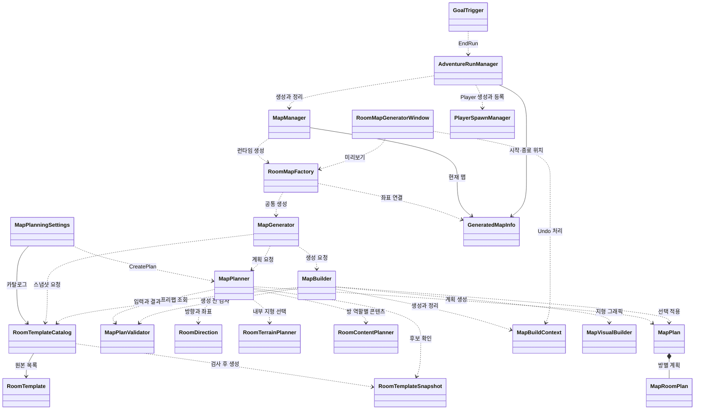

# 맵 조합 코드 구조

이 문서는 Chunk를 맵에 선택·연결하고 씬과 Run에 적용하는 코드를 설명한다. Chunk 내부 패턴과 콘텐츠를 선택하는 코드는 [Chunk 내부 조합 코드 구조](../Chunk_Generation/Work/Chunk_Generation_Code_Guide.md)를 참고한다.

## 입력과 결과

| 데이터 | 의미 |
| --- | --- |
| `RoomTemplate`, `RoomTemplateCatalog` | 제작한 방 프리팹과 생성에 사용할 방 목록이다. |
| `RoomTemplateSnapshot` | 카탈로그가 원본을 검사해 만든 계산용 읽기 전용 데이터다. 씬 오브젝트 참조 없이 출입구·통과 방향·마커와 내부 선택지를 보관한다. |
| `MapPlan`, `MapRoomPlan` | 격자·주 경로·시작과 Goal, 각 칸의 방 ID·연결·내부 선택을 보관한다. |
| `MapBuildResult`, `GeneratedMapInfo` | 생성 루트와 계획 또는 실패 사유를 반환하고, Run에 사용할 시작·종료 위치를 전달한다. |

방 하나는 20×20 단위다. 격자 y는 아래로 증가하므로 `(1, 2)`의 월드 원점은 `(20, -40)`이다. 좌표와 방향 변환은 `RoomDirection`이 담당한다.

## 클래스 관계

화살표는 호출하거나 사용하는 관계다. `*--`는 데이터 포함 관계이며 상속을 뜻하지 않는다. Chunk 내부 선택은 연결 지점만 표시한다.

## 실행 순서

### 계획

1. `MapGenerator.Generate()`가 설정과 카탈로그를 확인하고 `RoomTemplateCatalog.TryCreateSnapshot()`으로 원본 프리팹을 검사한다.
2. `MapPlanner.Create()`가 입력을 검사한 뒤 seed로 맨 위 행에서 시작하는 주 경로를 만든다. 각 행에서는 한 방향으로 이동하거나 다음 행으로 내려간다.
3. 경로의 각 칸에서 출입구·검증된 통과 방향·시작과 Goal 조건에 맞는 후보를 걸러낸 뒤 Base 그룹과 그 안의 템플릿을 순서대로 선택한다. 경로 밖은 출입구가 없는 `Side` 방으로 채운다. 이때 `RoomTerrainPlanner`가 해당 방의 내부 선택을 기록한다.
4. 조건을 만족하는 분기와 막다른 방이 있으면 연결 위치를 고른 뒤 각 방의 Base 그룹과 템플릿을 선택한다. 후보가 없으면 선택 방 없이 진행한다. 이후 확정된 중간 경로 방과 선택 방에 대해 `RoomContentPlanner`가 역할별 콘텐츠를 선택한다.
5. `MapPlanValidator`가 경로·이웃 출입구·마커·분기와 기록된 내부 선택을 검사한다. 실패하면 최대 시도 횟수까지 다시 계획하고, 끝내 실패하면 seed와 사유를 반환한다.

같은 설정·카탈로그·코드와 seed에서는 같은 계획을 만든다. Base 그룹과 템플릿을 ID 순서로 정렬하며 그룹 선택과 Variant 선택은 별도 난수를 사용한다. 같은 그룹에 Variant를 추가해도 해당 그룹의 선택 비중은 늘지 않는다. 지형·콘텐츠 선택도 별도 난수를 사용한다. 그룹 선택 도입이나 카탈로그·ID 변경 후에는 이전 seed의 결과가 달라질 수 있다.

### 씬 생성과 Run

1. `AdventureRunManager.StartRun()`이 `MapManager.GenerateMap()`을 요청한다. `MapManager`는 Inspector 설정에 따라 고정 또는 랜덤 seed를 사용한다.
2. `RoomMapFactory.TryCreate()`가 Goal 프리팹을 검사하고 `MapGenerator`를 호출한다.
3. `MapBuilder.Build()`가 카탈로그와 계획을 다시 검사한 뒤 비활성 루트 아래에 방과 확정된 패턴·콘텐츠·Goal을 만든다. 지형 그래픽이 설정돼 있으면 `MapVisualBuilder`가 방과 패턴의 지형을 공통 그래픽 Tilemap으로 표시한다.
4. `RoomMapFactory`가 루트에 `GeneratedMapInfo`를 추가해 시작·Goal 좌표를 기록한다. `MapManager`는 새 맵을 활성화한 뒤 이전 맵을 정리한다.
5. `AdventureRunManager`가 시작 좌표에 Player를 생성하고 준비를 확인해 등록한다. `GoalTrigger`는 접촉 또는 상호작용 시 `EndRun()`을 요청한다.

생성 도중 실패하면 새 루트를 정리하고 오류를 반환한다. 새 맵 생성에 실패하면 기존 맵을 유지하고, 활성화 중 예외가 나면 기존 맵을 다시 활성화한다.

### 에디터 미리보기

`RoomMapGeneratorWindow`도 `RoomMapFactory`를 호출한다. `MapBuildContext`에 Unity `Undo`용 생성·삭제·기록 함수를 전달하며, 성공 시 창이 소유한 이전 미리보기를 교체한다. 생성이 실패하면 기존 미리보기는 유지한다.

## 클래스와 소스

| 클래스 | 소스 | 역할 |
| --- | --- | --- |
| `RoomTemplateCatalog` | [RoomTemplateCatalog.cs](../../../Assets/Scripts/Map/RoomTemplates/RoomTemplateCatalog.cs) | 방 원본을 검사하고 ID 중복을 확인해 스냅샷을 만든다. |
| `MapPlanningSettings` | [MapPlanningSettings.cs](../../../Assets/Scripts/Map/RoomTemplates/MapPlanningSettings.cs) | 카탈로그·격자·최대 시도 횟수와 선택적 그래픽 타일·머티리얼을 보관한다. |
| `RoomTemplateSnapshot` | [RoomTemplateSnapshot.cs](../../../Assets/Scripts/Map/RoomTemplates/RoomTemplateSnapshot.cs) | 계획기에 필요한 방 정보와 검증된 통과 조건을 제공한다. |
| `MapPlanner`, `StableRandom` | [MapPlanner.cs](../../../Assets/Scripts/Map/RoomTemplates/MapPlanner.cs) | 주 경로·방·선택 방을 계획한다. `StableRandom`은 내부 난수 생성기다. |
| `RoomDirection` | [RoomDirection.cs](../../../Assets/Scripts/Map/RoomTemplates/RoomDirection.cs) | 방향의 반대편·인접 칸·방 원점과 유형별 출입구를 계산한다. |
| `MapPlan`, `MapRoomPlan`, `MapPlanningResult` | [MapPlan.cs](../../../Assets/Scripts/Map/RoomTemplates/MapPlan.cs) | 맵과 방별 계획, 계획 성공 또는 실패 정보를 담는다. |
| `MapPlanValidator` | [MapPlanValidator.cs](../../../Assets/Scripts/Map/RoomTemplates/MapPlanValidator.cs) | 입력과 완성 계획의 연결·마커·분기·내부 선택을 검사한다. |
| `MapGenerator` | [MapGenerator.cs](../../../Assets/Scripts/Map/RoomTemplates/MapGenerator.cs) | 스냅샷 생성, 계획과 Builder 호출을 조율한다. |
| `MapBuilder`, `MapBuildResult` | [MapBuilder.cs](../../../Assets/Scripts/Map/RoomTemplates/MapBuilder.cs) | 검증된 계획으로 씬을 생성하고 결과 또는 오류를 반환한다. |
| `MapVisualBuilder` | [MapVisualBuilder.cs](../../../Assets/Scripts/Map/RoomTemplates/MapVisualBuilder.cs) | Grid 충돌 셀을 수집해 공통 그래픽 Tilemap에 표시한다. 중복 셀이나 미지원 충돌 타입은 실패한다. |
| `MapBuildContext` | [MapBuildContext.cs](../../../Assets/Scripts/Map/RoomTemplates/MapBuildContext.cs) | 오브젝트 생성·기록·삭제 방식을 런타임과 에디터에서 제공한다. |
| `RoomMapFactory`, `GeneratedMapInfo` | [RoomMapFactory.cs](../../../Assets/Scripts/Map/MapRuntime/RoomMapFactory.cs), [GeneratedMapInfo.cs](../../../Assets/Scripts/Map/MapRuntime/GeneratedMapInfo.cs) | Goal을 검사하고 맵 결과에 Run용 시작·종료 위치를 연결한다. |
| `MapManager` | [MapManager.cs](../../../Assets/Scripts/Managers/GameManager/MapManger/MapManager.cs) | 런타임 seed와 현재 맵의 활성화·교체·정리를 담당한다. |
| `RoomMapGeneratorWindow` | [RoomMapGeneratorWindow.cs](../../../Assets/Editor/MapGenerator/RoomTemplates/RoomMapGeneratorWindow.cs) | 에디터 미리보기와 Undo·Redo를 담당한다. |
| `AdventureRunManager`, `PlayerSpawnManager`, `GoalTrigger`, `SceneFlowManager` | [AdventureRunManager.cs](../../../Assets/Scripts/Managers/AdventureRunManager/AdventureRunManager.cs), [PlayerSpawnManager.cs](../../../Assets/Scripts/Managers/PlayerManager/PlayerSpawnManager.cs), [GoalTrigger.cs](../../../Assets/Scripts/Managers/AdventureRunManager/GoalTrigger.cs), [SceneFlowManager.cs](../../../Assets/Scripts/Managers/GameManager/SceneFlowManager.cs) | 씬·Player·Run 시작과 종료를 연결한다. |

## 코드와 테스트 읽는 순서

1. `AdventureRunManager.StartRun()` → `MapManager.GenerateMap()` → `RoomMapFactory.TryCreate()`로 런타임 진입점을 확인한다.
2. `MapGenerator.Generate()` → `MapPlanner.Create()`를 읽고 `MapPlan`과 `MapPlanValidator`를 비교한다.
3. `MapBuilder.Build()`에서 방 ID와 계획의 선택을 실제 프리팹·타일로 바꾸는 부분을 읽는다. `RoomMapGeneratorWindow`의 컨텍스트와 비교하면 Undo 처리 차이를 볼 수 있다.
4. [MapPlannerTests.cs](../../../Assets/Tests/EditMode/MapGeneration/MapPlannerTests.cs), [MapBuilderTests.cs](../../../Assets/Tests/EditMode/MapGeneration/MapBuilderTests.cs), [RoomMapPreviewTests.cs](../../../Assets/Tests/EditMode/MapGeneration/RoomMapPreviewTests.cs)에서 계획·실패 정리·미리보기 검증을 확인한다.

계산 코드는 [ProjectRE.MapGeneration.asmdef](../../../Assets/Scripts/Map/RoomTemplates/ProjectRE.MapGeneration.asmdef)에 속한다. Factory와 Run 관련 클래스는 프로젝트 기본 어셈블리에 있다. 정적 계획 검사는 실제 Player의 충돌·이동을 보증하지 않으므로 Play 검증이 별도로 필요하다.
