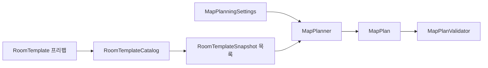

# 맵 연결 계획

맵 계획은 방을 씬에 생성하기 전에 주 경로, 방 프리팹 ID, 시작·Goal 위치를 결정하는 데이터다. 기본 설정은 4×4 격자이며, 격자 좌표는 오른쪽으로 x가 증가하고 아래쪽으로 y가 증가한다. 방 하나는 20×20 월드 단위다.

클래스별 책임과 코드 읽는 순서는 [맵 생성 코드 분석 가이드](../Map_Code_Architecture_Guide.md)를 참고한다.

## 데이터 흐름

- [RoomTemplate](../../../Assets/Scripts/Map/RoomTemplates/RoomTemplate.cs)은 제작자가 지정한 지형·출입구·통과 방향·마커를 보관한다.
- [RoomTemplateCatalog](../../../Assets/Scripts/Map/RoomTemplates/RoomTemplateCatalog.cs)는 원본 프리팹을 검사해 오브젝트 참조가 없는 스냅샷을 만든다. ID는 중복될 수 없다.
- [MapPlanningSettings](../../../Assets/Scripts/Map/RoomTemplates/MapPlanningSettings.cs)는 카탈로그, 격자 크기, 최대 시도 횟수를 보관한다. `CreatePlan(seed)`는 성공한 계획 또는 실패 사유를 반환한다.
- [MapPlanner](../../../Assets/Scripts/Map/RoomTemplates/MapPlanner.cs)는 위쪽 행에서 시작해 한 행 안에서 한 방향으로 이동하거나 아래로 내려간다. Goal까지 필수 경로를 확정한 뒤, 통과와 왕복이 검증된 후보가 있으면 중간 방의 좌우에 막다른 선택 방을 최대 하나 연결한다.
- [MapPlanValidator](../../../Assets/Scripts/Map/RoomTemplates/MapPlanValidator.cs)는 경로와 출입구가 서로 맞는지, 격자 바깥이나 경로 밖으로 열린 면이 없는지, 방의 통과와 마커 연결이 검증됐는지 검사한다.
- [MapPlan](../../../Assets/Scripts/Map/RoomTemplates/MapPlan.cs)은 각 셀의 템플릿 ID·유형·출입구·진입과 진출 방향, 순서가 있는 주 경로, 시작·Goal 월드 좌표와 seed를 보관한다.
- [RoomTerrainPlanner](../../../Assets/Scripts/Map/RoomTemplates/RoomTerrainPlan.cs)는 선택된 방의 영역별 패턴 ID와 확률 셀을 계획에 기록한다. Builder는 이 선택을 그대로 적용한다.
- [RoomContentPlanner](../../../Assets/Scripts/Map/RoomTemplates/RoomContent.cs)는 선택 방의 슬롯별 콘텐츠 ID 또는 빈 선택을 계획에 기록한다. Builder는 검증된 위치와 방향으로 프리팹을 생성한다.

같은 설정과 카탈로그에서 같은 seed는 같은 계획을 만든다. 후보 정렬과 난수 계산은 코드에 고정되어 있으며, 실패하면 seed와 마지막에 부족했던 연결 조건을 반환한다. 2~16 크기의 격자와 1~10000회의 시도를 지원한다.

지형 선택 난수는 주 경로와 방 선택 난수와 분리한다. seed, 방 좌표, 템플릿 ID, 영역 인덱스로 계산하므로 지형 설정을 추가해도 같은 seed의 경로와 방 선택은 유지된다. 패턴과 셀의 제작·검증 규칙은 [방 템플릿 제작 규격](../Chunk_Generation/Room_Template_Authoring_Guide.md#변형과-콘텐츠-마커)을 따른다.

선택 방 후보는 필수 경로의 진입→진출, 진입→분기, 분기→진출과 막다른 방의 입장·복귀가 모두 검증된 조합이다. 후보가 없으면 선택 방 없이 생성한다. 콘텐츠 난수도 경로·분기·지형 선택과 분리하므로 가중치를 변경해도 이들의 배치는 유지된다.

현재 기본 에셋은 [MapPlanningSettings](../../../Assets/Prefabs/@Data/Map/MapPlanningSettings.asset)와 [RoomTemplateCatalog](../../../Assets/Prefabs/@Data/Map/RoomTemplateCatalog.asset)다. 0~999 seed로 계획 불변 조건을 검사하는 [Edit Mode 테스트](../../../Assets/Tests/EditMode/MapGeneration/MapPlannerTests.cs)가 있다.

## 씬 생성과 Run 연결

`MapGenerator`는 설정으로 계획을 만들고 `MapBuilder`에 전달한다. Builder는 검증된 계획에 따라 비활성 루트 아래에 방과 Goal 프리팹을 생성한다. `RoomMapFactory`는 시작·Goal 좌표를 기존 Run에서 사용하는 `GeneratedMapInfo`로 연결한다.

런타임에서는 `MapManager`가 새 맵의 생성에 성공한 뒤 기존 맵을 교체한다. 생성 실패 시 기존 맵은 유지된다. `AdventureRunManager`는 시작 좌표에 Player를 생성하고 준비가 완료되면 등록한다. Goal에 닿으면 `GoalTrigger`가 Run을 종료한다. `MapManager`의 `Use Random Seed`를 켜면 실행 시 seed를 선택하고, 끄면 `Seed`에 지정한 값을 사용한다.

에디터에서는 **Map → Room Map Generator**를 열어 설정과 Goal 프리팹, seed를 지정한 뒤 **Generate Preview**를 누른다. 결과는 활성 씬에 생성되며 Undo·Redo를 지원한다. **Clear This Preview**는 해당 창이 생성한 미리보기만 삭제한다. 실패하면 기존 미리보기는 유지된다.
