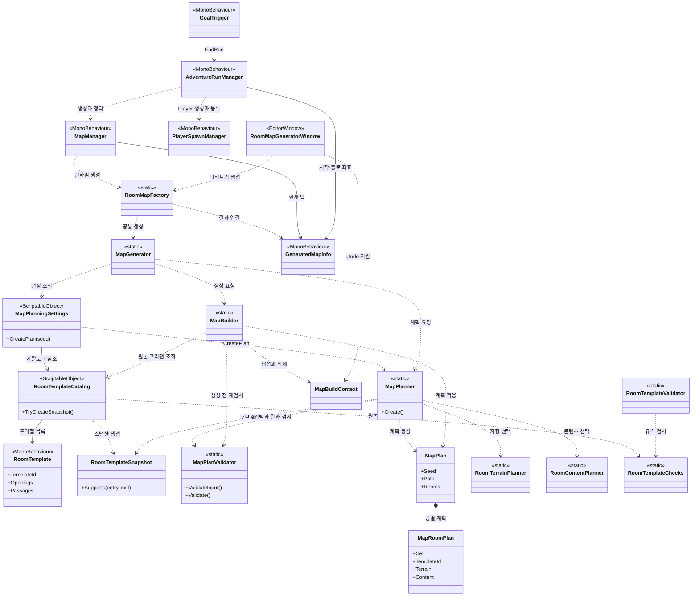

# 맵 생성 코드 분석 가이드

맵 생성에 참여하는 클래스의 역할과 의존 관계를 소스 기준으로 설명한다. 방 제작 좌표와 검증 절차는 [방 템플릿 제작 규격](Chunk_Generation/Room_Template_Authoring_Guide.md)을 따른다.

## 문서 읽는 순서

1. [스펠렁키식 청크 맵 재설계 계획](Spelunky_Chunk_Map_Plan.md): 목표와 맵 생성 방식의 전체 구조를 파악한다.
2. [맵 연결 계획](Map_Assembly/Map_Planning_Guide.md): 경로, 방 선택, 내부 지형·콘텐츠, 런타임과 미리보기의 데이터 흐름을 살펴본다.
3. **이 문서**: 실제 코드의 호출 순서와 클래스별 책임을 따라간다.
4. [방 템플릿 제작 규격](Chunk_Generation/Room_Template_Authoring_Guide.md): 프리팹을 직접 만들거나 수정할 때 출입구·지형·슬롯 설정과 이동 검증 방법을 확인한다.
5. [방 지형 타일과 그래픽 제작 계획](Chunk_Generation/Room_Tile_Visual_Plan.md): RuleTile 조사부터 대표 방 검증과 템플릿 확장까지 다음 작업 순서를 확인한다.

## 먼저 구분할 세 가지 데이터

| 데이터 | 생성·보관 위치 | 의미 |
| --- | --- | --- |
| 제작 원본 | `RoomTemplate` 프리팹과 `RoomTemplateCatalog` 에셋 | 제작자가 설정한 타일맵, 통로, 마커, 패턴·콘텐츠 프리팹이다. |
| 계산 입력 | `RoomTemplateSnapshot` | 카탈로그가 원본에서 만든 읽기 전용 데이터다. 경로 계산에 필요한 ID·방향·좌표·선택지를 담고 씬 오브젝트를 참조하지 않는다. |
| 계산 결과 | `MapPlan`과 `MapRoomPlan` | 어떤 격자 칸에 어떤 방을 놓고 내부에서 무엇을 선택할지 기록한다. `MapBuilder`가 이를 실제 오브젝트로 만든다. |

예를 들어 격자 `(1, 2)`에 배치할 방의 `TemplateId`, 출입구, 선택된 지형 패턴은 `MapRoomPlan`에 저장된다. Builder는 ID로 원본 프리팹을 찾아 복제하고, 기록된 선택을 적용한다. 방 하나의 월드 크기는 20×20이며 격자의 y는 아래로 증가하므로 `(1, 2)`의 원점은 월드 `(20, -40)`이다.

## 클래스 관계

화살표는 클래스가 다른 클래스를 **호출하거나 사용**하는 관계다. `*--`는 데이터를 포함하는 관계이고, 상속 관계를 뜻하지 않는다. 다이어그램은 핵심 연결을 보여 주며, 모든 유틸리티 호출은 아래 표에 설명한다.

## 실행 순서

### 런타임

1. `SceneFlowManager`가 게임 씬을 연 뒤 `AdventureRunManager.StartRun()`을 호출한다.
2. `AdventureRunManager`가 `MapManager.GenerateMap()`을 요청한다. `MapManager`는 Inspector 설정에 따라 랜덤 또는 고정 seed를 정한다.
3. `RoomMapFactory.TryCreate()`가 Goal 프리팹과 생성 컨텍스트를 확인하고 `MapGenerator.Generate()`를 호출한다.
4. `MapGenerator`가 카탈로그의 스냅샷을 만들고 `MapPlanner.Create()`를 호출한다. Planner는 입력 검사 → 주 경로 → 템플릿·지형 선택 → 가능한 경우 선택 방·콘텐츠 추가 → 완성된 계획 검증 순으로 처리한다.
5. `MapBuilder.Build()`가 카탈로그를 다시 검사하고 계획을 재검증한다. 비활성 맵 루트 아래에 방·지형·콘텐츠·Goal을 만든 뒤 `MapBuildResult`를 반환한다.
6. `RoomMapFactory`는 루트에 `GeneratedMapInfo`를 추가하고 계획의 시작·Goal 좌표를 기록한다. `MapManager`는 새 맵을 활성화한 뒤 기존 맵을 정리한다.
7. `AdventureRunManager`가 시작 좌표에 Player를 생성한다. 다음 프레임에 `IsReady`를 확인하고 Player를 등록한 뒤 `Playing` 상태로 전환한다. Goal에 닿으면 `GoalTrigger`가 Run 종료를 요청한다.

생성 도중 실패하면 Builder는 새로 만든 루트를 정리하고 오류를 반환한다. 새 맵 생성에 실패한 경우 `MapManager`는 이전 맵을 교체하지 않는다. 새 맵 활성화 중 예외가 발생한 경우에도 이전 맵을 다시 활성화한다.

### 에디터 미리보기

`RoomMapGeneratorWindow`도 `RoomMapFactory`와 같은 생성 흐름을 사용한다. 차이는 `MapBuildContext`의 생성·삭제 함수를 Unity `Undo`용으로 제공한다는 점이다. 성공하면 창이 소유한 이전 미리보기를 교체하고, 실패하면 이전 미리보기를 유지한다.

## 클래스별 역할과 소스

### 제작 원본과 검사

| 클래스 | 경로 | 역할 |
| --- | --- | --- |
| `RoomTemplate` | [RoomTemplate.cs](../../Assets/Scripts/Map/RoomTemplates/RoomTemplate.cs) | 방 프리팹에 붙는 제작 데이터. ID, 방 유형, 출입구, 통과 방향, 고정 Tilemap, 변형·보호 영역, 콘텐츠 슬롯, 시작·Goal 마커와 검증 표시를 보관한다. `OpeningCells()`가 출입구 셀의 기준이다. |
| `RoomType`, `RoomOpening`, `RoomPassage` | 위 `RoomTemplate.cs` | 방 유형, 방향 플래그, 진입→진출 방향을 표현한다. 출입구가 열려 있다는 사실과 실제 통과가 검증됐다는 사실은 별도다. |
| `RoomTerrainVariation`, `RoomTerrainPattern`, `RoomChanceCell` | 위 `RoomTemplate.cs` | 한 변형 영역의 패턴 후보와 확률 타일을 제작자가 설정한다. `combinationsVerified`는 수동으로 확인한 결과다. |
| `RoomContentSlot`, `RoomContentOption`, `ContentSurface`, `ContentFacing` | [RoomContent.cs](../../Assets/Scripts/Map/RoomTemplates/RoomContent.cs) | 콘텐츠 슬롯의 설치면·방향·여유 공간과 선택 프리팹·가중치를 정의한다. |
| `RoomTemplateChecks` | [RoomTemplateChecks.cs](../../Assets/Scripts/Map/RoomTemplates/RoomTemplateChecks.cs) | 프리팹의 지형, 경계, 통로, 마커, 변형 및 슬롯 규격을 검사한다. 실제 Player 이동 가능성은 제작자가 별도로 검증해야 한다. |
| `RoomTemplateValidator` | [RoomTemplateValidator.cs](../../Assets/Editor/MapGenerator/RoomTemplates/RoomTemplateValidator.cs) | **Map → Room Templates → Validate Selected** 메뉴에서 선택한 프리팹을 `RoomTemplateChecks`로 검사하고 결과를 Console에 출력한다. |
| `RoomTemplateCatalog` | [RoomTemplateCatalog.cs](../../Assets/Scripts/Map/RoomTemplates/RoomTemplateCatalog.cs) | 사용 가능한 `RoomTemplate` 목록을 보관한다. 각 원본의 유효성과 ID 중복을 검사하고 계산용 스냅샷을 만든다. |
| `MapPlanningSettings` | [MapPlanningSettings.cs](../../Assets/Scripts/Map/RoomTemplates/MapPlanningSettings.cs) | 카탈로그, 격자 크기와 최대 시도 횟수를 보관한다. `CreatePlan(seed)`는 씬 생성 없이 계획만 만들 때 사용하는 진입점이다. |

### 계산 입력·계획·검증

| 클래스 | 경로 | 역할 |
| --- | --- | --- |
| `RoomTemplateSnapshot` | [RoomTemplateSnapshot.cs](../../Assets/Scripts/Map/RoomTemplates/RoomTemplateSnapshot.cs) | 템플릿의 계산용 복사본이다. `Supports(entry, exit)`는 검증 표시와 기록된 방향을 함께 확인한다. |
| `RoomTerrainSnapshot`, `ContentSlotSnapshot`, `ContentOptionSnapshot` | [RoomTerrainPlan.cs](../../Assets/Scripts/Map/RoomTemplates/RoomTerrainPlan.cs), [RoomContent.cs](../../Assets/Scripts/Map/RoomTemplates/RoomContent.cs) | 각각 지형 영역과 콘텐츠 선택지에서 난수 선택에 필요한 값만 담는다. |
| `MapPlanner` | [MapPlanner.cs](../../Assets/Scripts/Map/RoomTemplates/MapPlanner.cs) | seed로 좌우·하강 주 경로를 정하고 각 칸에 조건을 만족하는 템플릿을 선택한다. 검증된 후보가 있으면 주 경로 옆에 막다른 선택 방을 최대 하나 추가한다. 오브젝트를 생성하지 않는다. |
| `MapPlanner.StableRandom` | 위 `MapPlanner.cs` | Planner 내부의 비공개 난수 생성기다. seed가 같을 때 경로와 템플릿 선택을 재현할 수 있도록 난수 계산을 고정한다. |
| `RoomDirection` | [RoomDirection.cs](../../Assets/Scripts/Map/RoomTemplates/RoomDirection.cs) | 방향의 반대편, 인접 격자, 두 칸 사이 방향, 방 원점과 유형·출입구 관계를 계산하는 내부 유틸리티다. |
| `RoomTerrainPlanner` | [RoomTerrainPlan.cs](../../Assets/Scripts/Map/RoomTemplates/RoomTerrainPlan.cs) | 방의 변형 영역별 패턴과 채울 확률 셀을 선택한다. 경로 선택과 독립된 난수 계산을 사용한다. |
| `RoomContentPlanner` | [RoomContent.cs](../../Assets/Scripts/Map/RoomTemplates/RoomContent.cs) | 선택 방의 슬롯마다 가중치에 따라 콘텐츠 ID 또는 빈 선택을 결정한다. 경로·지형과 독립된 난수 계산을 사용한다. |
| `RoomTerrainSelection`, `ContentSelection` | [RoomTerrainPlan.cs](../../Assets/Scripts/Map/RoomTemplates/RoomTerrainPlan.cs), [RoomContent.cs](../../Assets/Scripts/Map/RoomTemplates/RoomContent.cs) | 각각 확정된 패턴·셀과 슬롯별 콘텐츠 ID를 보관한다. 빈 ID는 빈 선택을 뜻한다. |
| `MapPlan`, `MapRoomPlan` | [MapPlan.cs](../../Assets/Scripts/Map/RoomTemplates/MapPlan.cs) | `MapPlan`은 전체 격자·seed·경로·시작과 Goal 좌표를, `MapRoomPlan`은 한 칸의 템플릿·통로·분기·내부 선택을 보관한다. |
| `MapPlanningResult` | 위 `MapPlan.cs` | 계획 성공 시 `Plan`, 실패 시 `Error`와 시도 횟수를 전달한다. |
| `MapPlanValidator` | [MapPlanValidator.cs](../../Assets/Scripts/Map/RoomTemplates/MapPlanValidator.cs) | 입력 범위·ID를 검사하고 완성 계획의 경로, 이웃 출입구, 마커, 분기 및 지형·콘텐츠 선택의 일관성을 검사한다. Planner와 Builder가 각각 사용한다. |

### 씬 생성과 Run 연결

| 클래스 | 경로 | 역할 |
| --- | --- | --- |
| `MapGenerator` | [MapGenerator.cs](../../Assets/Scripts/Map/RoomTemplates/MapGenerator.cs) | 카탈로그 스냅샷 생성, Planner 호출, Builder 호출을 연결하는 공통 진입점이다. |
| `MapBuilder` | [MapBuilder.cs](../../Assets/Scripts/Map/RoomTemplates/MapBuilder.cs) | 계획을 재검증하고 원본 프리팹을 찾아 비활성 루트 아래에 실제 방·패턴·콘텐츠·Goal을 만든다. 계획에서 이미 확정한 선택을 적용한다. |
| `MapBuildResult` | 위 `MapBuilder.cs` | 생성 성공 시 루트와 계획을, 실패 시 오류를 전달한다. |
| `MapBuildContext` | [MapBuildContext.cs](../../Assets/Scripts/Map/RoomTemplates/MapBuildContext.cs) | 루트·프리팹·컴포넌트 생성, 컴포넌트 기록과 오브젝트 삭제 함수를 제공한다. 런타임 기본 동작과 에디터 Undo 동작을 같은 Builder에 전달한다. |
| `RoomMapFactory` | [RoomMapFactory.cs](../../Assets/Scripts/Map/MapRuntime/RoomMapFactory.cs) | Goal 프리팹을 검사하고 공통 생성기를 호출한다. 생성 루트에 `GeneratedMapInfo`를 추가해 Run에서 사용할 좌표를 연결한다. |
| `GeneratedMapInfo` | [GeneratedMapInfo.cs](../../Assets/Scripts/Map/MapRuntime/GeneratedMapInfo.cs) | 생성 루트에 붙어 Player 시작 위치와 종료 위치를 보관한다. Player를 직접 생성하지 않는다. |
| `MapManager` | [MapManager.cs](../../Assets/Scripts/Managers/GameManager/MapManger/MapManager.cs) | 런타임 seed와 설정을 선택하고 Factory를 호출한다. 현재 맵의 활성화·교체·정리를 담당한다. |
| `AdventureRunManager` | [AdventureRunManager.cs](../../Assets/Scripts/Managers/AdventureRunManager/AdventureRunManager.cs) | 맵 생성 후 Player 준비·등록과 Run 상태를 관리한다. 클리어·실패 시 Player와 맵을 정리하는 흐름을 소유한다. |
| `PlayerSpawnManager` | [PlayerSpawnManager.cs](../../Assets/Scripts/Managers/PlayerManager/PlayerSpawnManager.cs) | Player 프리팹을 지정된 위치에 만들고 등록·정리한다. 생성기의 경로 계산에는 참여하지 않는다. |
| `GoalTrigger` | [GoalTrigger.cs](../../Assets/Scripts/Managers/AdventureRunManager/GoalTrigger.cs) | 접촉 또는 상호작용으로 Goal에 도달하면 `AdventureRunManager.EndRun()`을 요청한다. |
| `SceneFlowManager` | [SceneFlowManager.cs](../../Assets/Scripts/Managers/GameManager/SceneFlowManager.cs) | 씬 전환 후 Run 시작을 요청하고 시작 실패 시 Title로 복귀한다. |
| `RoomMapGeneratorWindow` | [RoomMapGeneratorWindow.cs](../../Assets/Editor/MapGenerator/RoomTemplates/RoomMapGeneratorWindow.cs) | 에디터에서 설정·seed·Goal을 받아 미리보기를 생성하고 창이 소유한 결과에 대해 Undo·Redo와 정리를 처리한다. |

## 코드를 따라가는 순서

1. **실행 진입점:** `AdventureRunManager.StartRun()` → `MapManager.GenerateMap()` → `RoomMapFactory.TryCreate()`.
2. **계획:** `MapGenerator.Generate()` → `RoomTemplateCatalog.TryCreateSnapshot()` → `MapPlanner.Create()`. `MapPlan`과 `MapPlanValidator`를 함께 읽는다.
3. **방 내부 선택:** `MapPlanner.TrySelect()`와 `AddOptionalRoom()`에서 `RoomTerrainPlanner`·`RoomContentPlanner`가 호출되는 지점을 본다.
4. **씬 생성:** `MapBuilder.Build()`에서 `MapRoomPlan`의 ID와 선택값을 프리팹·타일로 바꾸는 부분을 본다. `MapBuildContext`와 `RoomMapGeneratorWindow.Generate()`를 비교하면 런타임과 Undo 처리 차이를 확인할 수 있다.
5. **완료와 정리:** `AdventureRunManager.StartRun()`의 Player 준비 확인, `GoalTrigger.Reach()`, `AdventureRunManager.ClearRunObjects()`를 확인한다.

방 연결의 기대 결과는 [MapPlannerTests.cs](../../Assets/Tests/EditMode/MapGeneration/MapPlannerTests.cs), 생성·실패 정리는 [MapBuilderTests.cs](../../Assets/Tests/EditMode/MapGeneration/MapBuilderTests.cs), 지형·콘텐츠와 선택 방은 [RoomTerrainTests.cs](../../Assets/Tests/EditMode/MapGeneration/RoomTerrainTests.cs)와 [OptionalRoomTests.cs](../../Assets/Tests/EditMode/MapGeneration/OptionalRoomTests.cs), 미리보기 Undo는 [RoomMapPreviewTests.cs](../../Assets/Tests/EditMode/MapGeneration/RoomMapPreviewTests.cs)에서 확인할 수 있다.

## 현재 구조에서 주의할 점

- 경로는 좌우 이동과 하강을 사용하며, 주 경로 밖의 선택 방은 최대 하나다. 콘텐츠 선택은 현재 선택 방에만 적용된다.
- `Passages Verified`와 `Combinations Verified`는 실제 이동을 검증한 뒤 제작자가 설정하는 표시다. 지형 등을 변경해도 자동으로 해제되지 않으므로 다시 확인해야 한다.
- 런타임과 에디터는 공통 생성기를 사용하지만 `RoomMapGeneratorWindow`는 편집용 Undo 컨텍스트를 제공한다. MonoBehaviour 생명주기와 실제 충돌 검증은 Play Mode에서 별도로 확인한다.
- 생성 계산 코드는 [ProjectRE.MapGeneration.asmdef](../../Assets/Scripts/Map/RoomTemplates/ProjectRE.MapGeneration.asmdef)에 속한다. `RoomMapFactory`, `MapManager`와 Run 관련 클래스는 별도 어셈블리 정의가 없는 프로젝트 기본 어셈블리에 있다.
