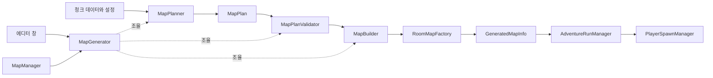

# 스펠렁키식 청크 맵 재설계 계획

## 목표와 결정 사항

방 유형별 템플릿으로 시작점부터 출구까지 이어지는 맵을 만들고, 템플릿 내부의 지형과 콘텐츠를 조합한다. 제작 규칙과 클래스의 책임을 명확히 하여, 제작자가 생성 결과를 이해하고 문제를 재현할 수 있게 한다.

- 진행 방식은 스펠렁키식 좌우 이동·하강 중심으로 정한다.
- 청크별로 상하좌우 중 필요한 출입구 조합을 지정한다.
- 1차는 **방 템플릿 규격과 고정 지형을 이용한 연결**, 2차는 **템플릿 내부의 패턴·확률 셀·콘텐츠 조합** 순서로 개발한다.
- 초기 필수 경로는 현재 Player의 이동·점프·대쉬로 통과하도록 제작한다.

## 참고한 스펠렁키 구조

조사 범위는 Spelunky Classic과 Darius Kazemi의 실행 가능한 분석 도구다.

1. 먼저 방 격자에서 시작점과 출구를 잇는 주 경로를 정한다. 참고 구현은 4×4 격자에서 좌우로 이동하다 내려가며, 경로 밖의 칸을 별도로 채운다. [경로 생성 분석](https://tinysubversions.com/spelunkyGen/)
2. 기본 방 유형은 경로 밖 방, 좌우 통과 방, 하강 방, 상부 진입 방의 네 가지다. 유형은 필요한 연결을 보장하는 분류이고, 각 유형에는 보통 8~16개의 템플릿이 있다. [방 유형 분석](https://tinysubversions.com/spelunkyGen/), [방 내부 생성 분석](https://tinysubversions.com/spelunkyGen2/)
3. 참고 구현의 방 템플릿은 10×8 타일이며, 고정 지형·확률 타일·5×3 장애물 패턴을 조합한다. 제작자가 만든 고정 배치와 생성 시 선택하는 요소가 함께 들어간다. [방 내부 생성 분석](https://tinysubversions.com/spelunkyGen2/)
4. 공식 사이트에는 Classic의 원본과 소스가 공개되어 있다. [공식 Classic 페이지](https://www.spelunkyworld.com/original.html)

이 프로젝트에는 **경로와 방 유형 결정 → 템플릿 선택 → 내부 조합 → Tilemap·콘텐츠 생성** 순서를 적용한다. 출입구 연결과 Player의 실제 통과 가능성을 각각 검증한다.

## 현재 구현

현재 호출 관계:

```text
RoomMapGeneratorWindow ──────────────┐
                                     ▼
AdventureRunManager → MapManager → RoomMapFactory → MapGenerator
                                                       ├─ MapPlanner → MapPlanValidator
                                                       └─ MapBuilder → 방·Goal 생성

RoomMapFactory → GeneratedMapInfo → AdventureRunManager → PlayerSpawnManager
GoalTrigger → AdventureRunManager.EndRun()
```

`RoomTemplateCatalog`의 프리팹에서 읽기 전용 스냅샷을 만들어 계획을 검증한다. 런타임 seed는 `MapManager`에서 지정한다. 공용 타일과 장식은 방 템플릿과 내부 패턴에서 사용한다.

현재 Run은 `MapManager.GenerateMap()` 결과로 Player를 생성하고, `IsReady` 확인 후 Player를 등록한다. Monster는 등록 이벤트로 Player를 연결한다. 이 수명주기는 유지하며, 맵 생성기가 FSM의 State나 공격 데이터를 구성하지 않게 한다.

## 제작 규칙과 생성 절차

### 1차: 방 템플릿 규격과 연결

- 첫 검증 맵은 4×4 방 격자를 기준으로 한다. 방 크기는 우선 20×20 월드 단위, Tilemap 셀은 1단위로 맞추고 Player의 이동 범위와 실제 지형 경계를 점검한다. 맵의 한 칸은 방 하나다.
- 제작 원본은 Tilemap과 마커를 담은 방 템플릿 프리팹으로 관리한다. 방 유형, 고정 지형, 변형 영역의 경계, 콘텐츠 슬롯을 구분한다. 1차 생성은 고정 지형으로 연결을 검증하고, 2차에서 변형 영역의 선택을 실행한다.
- 생성기는 템플릿에서 읽기 전용 데이터를 구성하고 선택 결과를 계획에 저장한다. Builder는 계획에 따라 고정 지형을 복제하고 확정된 내부 선택을 적용한다.
- 청크의 기준점을 통일하고 회전 0·스케일 1로 배치한다.
- 출입구는 방향뿐 아니라 열린 구간의 위치·폭, 진입 여유 공간, 착지면을 함께 규격화한다. 기존 기준 좌표인 W `(0,6)`, E `(20,6)`, S `(15,0)`, N `(15,20)`은 지형 감사의 출발점으로 사용한다.
- 청크마다 검증한 진입→진출 조합을 기록한다. N→S 하강 통과와 S→N 상승 통과는 각각 검증한다.
- Player 시작 위치와 Goal 위치는 일반 콘텐츠 스폰 좌표에서 분리한다. Goal 위치의 트리거와 주변 발판도 검증한다.

생성 순서:

1. 설정과 청크 목록을 검사하고 실제 사용한 seed를 확정한다.
2. 맨 위 행의 시작 방부터 좌우 이동·하강으로 주 경로를 만든다. 한 행에서 되짚지 않으며, 마지막 행의 출구 위치와 각 방의 유형을 확정한다.
3. 방 유형과 필요한 출입구·진입→진출 조건을 충족하는 템플릿을 선택한다. 시작·출구 마커의 배치 조건도 이 단계에 반영한다.
4. 경로 밖은 막힌 채움 청크로 처리한다. 주 경로 완성 후 검증된 연결이 있으면 중간 방의 좌우에 막다른 선택 방을 최대 하나 추가한다.
5. 계획된 연결은 양쪽 출입구가 맞아야 한다. 연결하지 않은 면은 닫힌 템플릿을 사용하고, 대응하는 이웃이 없는 열린 통로를 남기지 않는다.
6. 계획을 검증한 다음 프리팹을 생성한다. 후보가 없으면 제한된 횟수만 다시 계획하고, 한도를 넘으면 부족한 연결 형태와 seed를 포함해 실패를 반환한다.

경로 밖·좌우 통과·하강·상부 진입 유형의 기본 템플릿과 시작·출구 마커를 준비한다. 방 유형은 주 경로에 필요한 최소 연결을 나타내며, 실제 출입구와 통과 방향을 함께 검사한다. 하강이 연속되는 방의 상단 연결도 검증한다.

### 기존 청크 전환

- 출입구와 통과 조건이 맞는 지형은 방 템플릿의 고정 부분으로 사용한다. 예를 들어 기존 EW 지형은 좌우 통과 유형의 후보가 될 수 있다.
- 발판·장애물 일부는 경계 조건을 맞춰 내부 패턴으로 분리한다. Tile·Sprite·장식 프리팹은 새 템플릿에서도 사용한다.
- 기존 문 위치와 방 크기는 제작·이동 검증 결과에 따라 확정한다. 재사용할 청크도 새 방 유형의 연결 조건에 맞게 수정한다.
- 전환된 템플릿은 기존 청크 프리팹과 독립적으로 관리한다.

### 2차: 청크 내부 랜덤 배치

두 작업을 순서대로 나눈다.

1. **지형 조합:** 지정한 작은 영역을 미리 검증한 발판·장애물 패턴으로 채우고, 통과 조건에 영향을 주지 않는 셀에 확률 선택을 적용한다. 영역의 경계 연결과 통과 조건을 통일하고, 출입구·필수 착지면·통과 공간을 보호한다.
2. **콘텐츠 배치:** 확정된 지형의 안전한 슬롯에서 몬스터·아이템·장식 등을 선택한다. 슬롯은 허용 목록, 가중치, 비워둘 확률, 방향을 가진다. 지상 몬스터는 바닥 지지와 몸통 공간이 있는 위치에 놓고, 함정은 설치면과 방향이 맞는 슬롯에만 놓는다.

지형 변형은 청크 선택 후 계획에서 확정하고, 콘텐츠는 최종 지형에 맞춰 배치한다. 변형 영역끼리 겹치지 않게 하며, 각 패턴이 경계에서 같은 통과 조건을 유지하도록 제작한다. 선택된 청크·변형·콘텐츠와 위치를 계획에 저장한다.

## 클래스 책임과 의존성

| 책임 / 제안 이름 | 담당 내용 | 의존성 경계 |
| --- | --- | --- |
| `RoomTemplate` | 제작 원본 프리팹의 방 유형, 고정 Tilemap, 출입구·통과 방향, 지형 변형과 마커를 정의한다. | 데이터의 원본이며 생성 알고리즘이나 난수 실행을 포함하지 않는다. |
| `RoomTemplateCatalog` + `MapPlanningSettings` | 사용할 템플릿 목록, 방 격자와 시도 횟수를 보유한다. | 출입구 수치의 별도 수동 캐시를 두지 않는다. |
| `MapPlan` | 방 좌표·유형·연결, 템플릿 ID, 시작·Goal, 확정된 내부 선택과 seed를 보관한다. | 씬 오브젝트 참조·FSM 상태를 보관하지 않는다. |
| `MapPlanner` | 주 경로와 방 유형·템플릿을 선택해 `MapPlan`을 만든다. | 읽기 전용 템플릿 스냅샷을 사용하며 `Instantiate`, Physics 조회, Managers 접근을 하지 않는다. |
| `RoomTerrainPlanner` | 방별 패턴과 확률 셀 선택을 계획에 기록한다. | 주 경로와 별도의 난수를 사용한다. |
| `RoomContentPlanner` | 선택 방 슬롯의 가중치에 따라 콘텐츠 또는 빈 슬롯을 계획에 기록한다. | 경로·분기·지형과 별도의 난수를 사용한다. |
| `MapPlanValidator` | 필요한 연결, 경계, 시작·Goal, 기록된 통과 조건과 계획의 일관성을 검사한다. | 제작 데이터에 기록된 연결 조건을 대상으로 자동 검증한다. |
| `MapBuilder` | 검증된 계획대로 템플릿의 고정 지형을 복제하고 내부 조합·마커·콘텐츠를 적용한 뒤 루트를 반환한다. | 경로·패턴을 다시 추첨하거나 FSM을 구성하지 않는다. |
| `MapGenerator` | 계획 → 검증 → 생성 순서를 조율하는 공통 진입점이다. | 에디터·런타임이 이 흐름을 공유한다. 탐색·배치 계산은 담당 클래스에 맡긴다. |
| `RoomMapFactory` | 생성된 루트에 `GeneratedMapInfo`를 연결한다. | Goal 프리팹을 검사하고 기존 Run과 공통 생성기를 연결한다. |
| 기존 `MapManager` | 공통 생성기를 호출하고 현재 맵 루트를 소유한다. | `AdventureRunManager`에는 성공한 맵 정보만 전달한다. |
| 에디터 도구 | 방 템플릿·변형 영역·콘텐츠 슬롯의 제작과 검사, seed 재현, 생성 결과 확인을 제공한다. | 공통 생성기에 에디터용 생성·삭제 방식을 전달한다. |



공통 계약:

- **SRP / DIP:** 계산과 Unity 생성을 분리하고 `MapBuildContext`로 생성·삭제 방식을 전달한다.
- **OCP:** 청크 추가는 카탈로그 등록으로, 같은 배치 규칙의 몬스터·아이템 추가는 슬롯의 프리팹 목록 변경으로 처리한다. 새로운 설치 규칙이 필요해지면 해당 규칙을 담당하는 확장 지점을 만든다.
- **DRY:** 청크 제작 데이터와 설정을 원본으로 삼고, 검사·미리보기·런타임이 같은 계산을 호출한다. DB와 프리팹, 에디터와 런타임에 출입구 공식을 중복하지 않는다.
- **실패 처리:** 실패한 계획은 씬을 변경하지 않는다. 새 맵은 비활성 임시 루트 아래에 생성하고 위치·참조 확인 후 활성화한다. 생성 실패 시 임시 루트를 정리하며, 기존 맵 교체는 새 맵의 생성 성공 후 수행한다. 전역 이름 검색으로 다른 맵 루트를 삭제하지 않는다.
- **FSM 연결:** 최종 배치 위치를 설정한 후 캐릭터를 활성화한다. Player 생성·준비 확인·등록은 기존 Run 흐름이 담당한다. `GeneratedMapInfo`는 전환 초기의 호환 경계로 유지한다.
- **재현:** 같은 설정·카탈로그 버전·알고리즘 버전·seed에서 같은 계획을 만든다. 목록 순서를 안정화하고, 2차 단계에서는 경로·청크 선택·내부 배치 난수를 분리한다. 방 좌표와 고정된 ID를 기준으로 파생 seed를 계산하며 문자열의 런타임 `GetHashCode()`에 의존하지 않는다.

## 핵심 작업 단계

- [x] **템플릿 제작 규격 확정:** 방 유형, 고정 Tilemap·변형 영역·콘텐츠 슬롯의 구분과 출입구 규격을 정한다. 실제 사용 중인 `ProjectRE_Player Variant`로 문 폭·착지 여유·점프 구간을 확인한다. 결과: [템플릿 입력 규격](Chunk_Generation/Room_Template_Authoring_Guide.md)과 유형별 샘플.
- [x] **기존 지형 전환:** 기존 청크에서 고정 지형·패턴·장식을 골라 새 템플릿으로 전환한다. 결과: [전환 템플릿과 패턴 후보](Chunk_Generation/Room_Template_Authoring_Guide.md#기존-청크-전환).
- [x] **연결 계획 구현:** 고정 지형을 가진 방 템플릿으로 주 경로·출구를 계획하고 검증한다. 결과: [배치 데이터와 실패 이유](Map_Assembly/Map_Planning_Guide.md).
- [x] **씬 생성과 Run 연결:** 같은 계획을 런타임과 에디터에서 생성하고 `GeneratedMapInfo`, Player 준비·등록, `GoalTrigger`를 연결한다. 결과: 새 맵에서 시작부터 클리어까지 플레이 가능. [생성 및 미리보기 사용법](Map_Assembly/Map_Planning_Guide.md#씬-생성과-run-연결).
- [x] **내부 지형 조합:** 보호된 통로 바깥의 제한된 영역부터 패턴과 확률 셀을 적용한다. 결과: 같은 연결을 유지하면서 내부 구성이 달라짐. [제작 및 검증 규칙](Chunk_Generation/Room_Template_Authoring_Guide.md#변형과-콘텐츠-마커).
- [x] **선택 방과 콘텐츠 배치:** 주 경로를 확정한 뒤 검증된 막다른 선택 방을 연결하고 슬롯의 설치면·공간과 가중치에 따라 콘텐츠를 배치한다. [제작 규칙](Chunk_Generation/Room_Template_Authoring_Guide.md#변형과-콘텐츠-마커).
- [x] **기존 구현 정리:** 이전 생성기·유틸리티·스폰 선택기·DB와 미사용 청크 프리팹을 제거하고 seed 설정을 `MapManager`로 전환한다. 공용 타일·장식은 유지한다.

구현 위치는 생성 데이터와 계산을 `Assets/Scripts/Map/`, 에디터 기능을 `Assets/Editor/MapGenerator/`로 모으고, `MapManager`는 Run과 연결하는 얇은 진입점으로 둔다.

## 검증 기준

- **계획 자동 검증:** 고정 seed 범위(예: 0~999)를 대상으로 시작·출구, 격자 범위, 겹침, 출입구 대응, 명시된 주 경로와 통과 방향을 확인한다. 생성이 불가능한 입력은 제한 시간 안에 이유를 반환하고 부분 성공으로 처리하지 않는다.
- **경계 입력:** 필요한 템플릿 누락, 시작·Goal 마커 누락, 잘못된 문 규격, 지원하지 않는 격자 설정은 생성 전에 검출한다. 난수 결과가 같은지, 콘텐츠 설정만 바꿔도 주 경로가 유지되는지 확인한다.
- **제작 데이터 검증:** 실제 Collider 형상과 통로·착지 공간을 확인한다. 현재 사용되는 PlayerMotorData는 이동 5, 점프 힘 8, 대쉬 속도 12·거리 5, 공중 대쉬 1회이며, 대쉬는 수평 이동이다. 수치만으로 임의 지형의 통과 가능성을 단정하지 않는다.
- **Play 검증:** 실제 Player의 직접 조작 또는 Input System 가상 입력으로 대표 청크의 각 진입→진출, 청크 경계 점프·착지, 시작부터 Goal 도달, Monster의 Player 연결, 실패 후 정리·재시작을 상태와 Console로 확인한다.
- **2차 검증:** 모든 지형 패턴이 같은 경계 조건을 유지하는지, 슬롯의 프리팹이 지형·다른 스폰·필수 통로와 겹치지 않는지 확인한다. 콘텐츠를 변경해도 검증된 통과 구간이 유지되어야 한다.

## 주요 소스

- [맵 관리자](../../Assets/Scripts/Managers/GameManager/MapManger/MapManager.cs), [생성 결과](../../Assets/Scripts/Map/MapRuntime/GeneratedMapInfo.cs)
- [Run 시작·종료](../../Assets/Scripts/Managers/AdventureRunManager/AdventureRunManager.cs)
- [Player 이동 데이터](../../Assets/Prefabs/Player/ScriptableObjects/PlayerMotorData.asset)
- [맵 계획 설정](../../Assets/Prefabs/@Data/Map/MapPlanningSettings.asset), [방 템플릿 카탈로그](../../Assets/Prefabs/@Data/Map/RoomTemplateCatalog.asset)
- [맵 계획기](../../Assets/Scripts/Map/RoomTemplates/MapPlanner.cs), [계획 검증](../../Assets/Scripts/Map/RoomTemplates/MapPlanValidator.cs), [계획 데이터](../../Assets/Scripts/Map/RoomTemplates/MapPlan.cs)
- [맵 생성](../../Assets/Scripts/Map/RoomTemplates/MapGenerator.cs), [방 배치](../../Assets/Scripts/Map/RoomTemplates/MapBuilder.cs), [Run 연결](../../Assets/Scripts/Map/MapRuntime/RoomMapFactory.cs), [미리보기 창](../../Assets/Editor/MapGenerator/RoomTemplates/RoomMapGeneratorWindow.cs)
- [콘텐츠 선택](../../Assets/Scripts/Map/RoomTemplates/RoomContent.cs), [선택 방·콘텐츠 테스트](../../Assets/Tests/EditMode/MapGeneration/OptionalRoomTests.cs)
- [대쉬 실행](../../Assets/Scripts/FSM/Player/Handler/AgentDashHandler2D.cs)
- [Monster 초기화와 Player 연결](../../Assets/Scripts/FSM/NPC/AIMonstor/@Hub/MonsterController.cs)
- [작업 지침](../Skill/AGENTS.md), [계획 가이드](../Skill/Plan_Guide.md)
